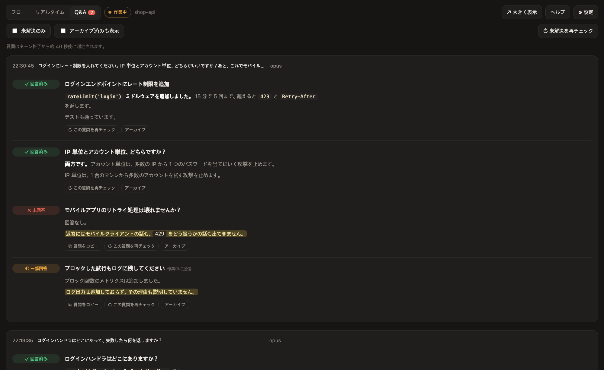
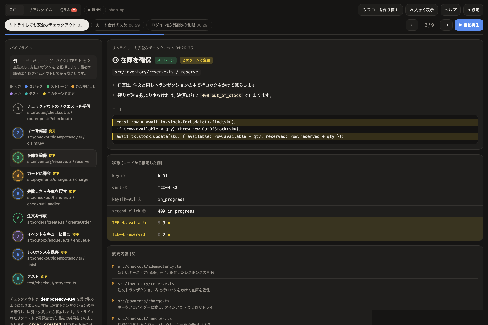
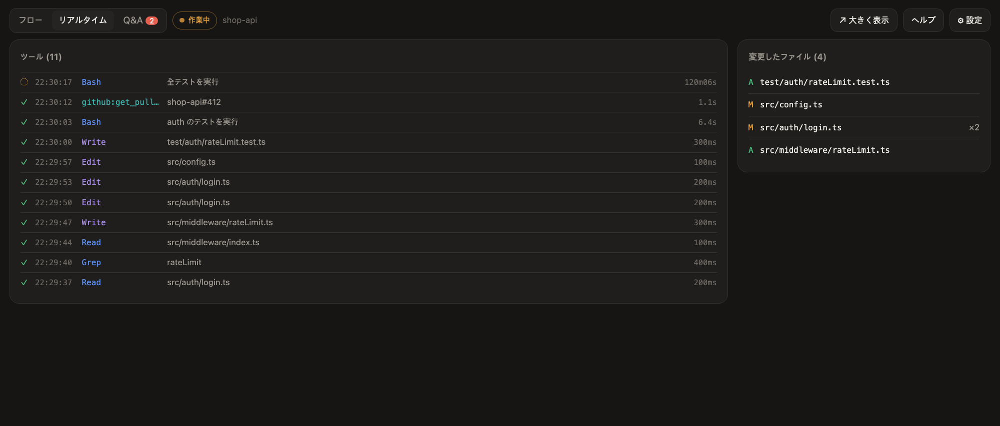
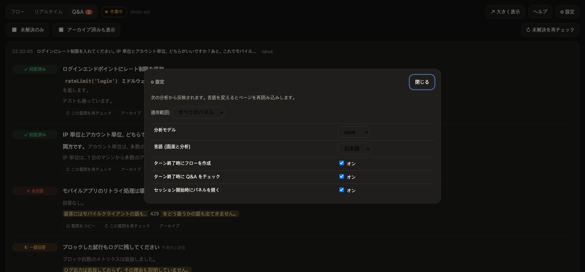
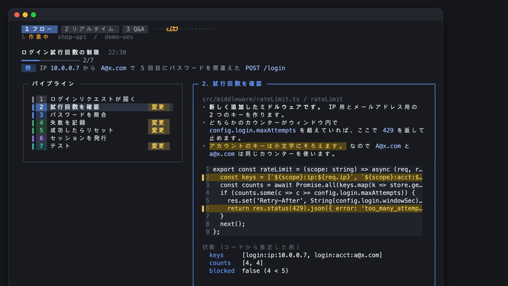
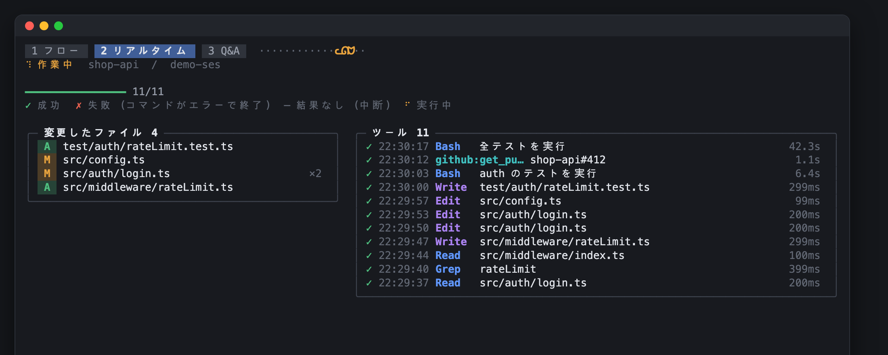
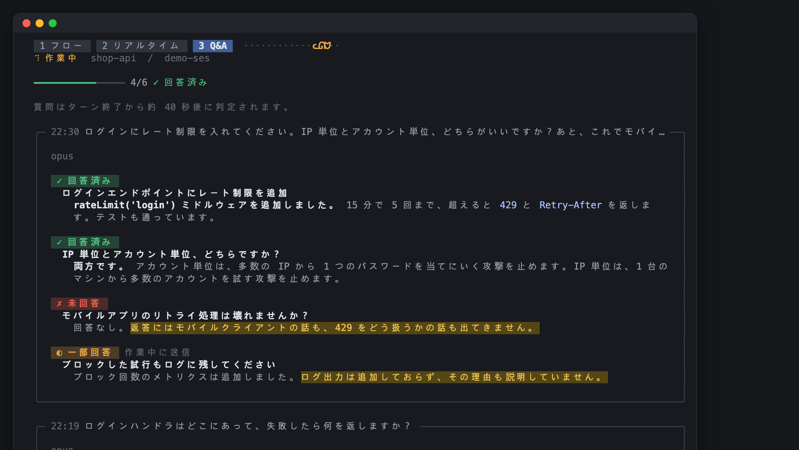
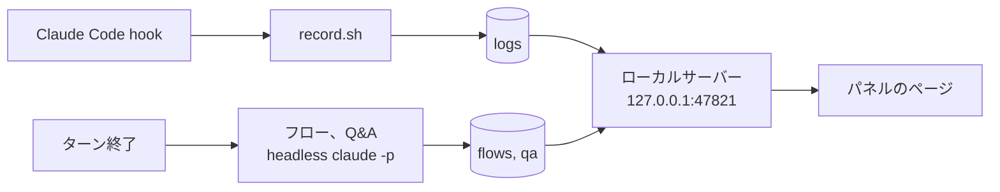

# Claude Side Insights

[English](README.md) | [한국어](README.ko.md) | **日本語**

## インストール

Claude Code の中で:

```
/plugin marketplace add wonjoonSeol-WS/claude-side-insights
/plugin install side-insights@claude-side-insights
/reload-plugins
```

次に Claude の横にパネルを開きます:

```
! claude-panel
```

cmux、Orca、Ghostty、iTerm2 では新しいセッションを始めると自動で開きます。もう一度実行すると隠れます。

更新:

```
/plugin marketplace update claude-side-insights
/plugin update side-insights@claude-side-insights
```

`/plugin` > Marketplaces で自動更新をオンにもできます。

## 表示されるもの


**Claude は質問に全部答えた? 何を変えた? 今何をしている?**

[Claude Code](https://claude.com/claude-code) のペインの横に表示されるパネルです。ターンが終わるたびに更新されます。

| タブ | 表示されるもの |
|---|---|
| **Q&A** | 送ったすべての質問 (作業中に送ったものも): ✓ 回答済み、◐ 一部回答、✗ 未回答。足りない部分をハイライトします。**⧉ 質問をコピー** で聞き直せます。 |
| **フロー** | ファイルを編集したターンの後に: 変わった機能をステップごとに、実際のコードと変更行のハイライト付きで。 |
| **リアルタイム** | 実行中のツール呼び出しと、変更されたファイル。 |

English、한국어、日本語に対応しています。

## 画面

*架空のプロジェクトで作った例です。*

**ブラウザパネル**: cmux のようにブラウザを備えたターミナル、または `claude-flow` で開いたブラウザではこう表示されます。

| Q&A | フロー |
|---|---|
|  |  |
| **リアルタイム** | **設定** |
|  |  |

フロータブは一つの例をすべてのステップで追います。値はコードから推定したもので、実行時に取得したものではありません。

**ターミナルパネル** (iTerm2、Ghostty、Orca): 同じ三つのタブをターミナルに描きます。

| フロー | リアルタイム | Q&A |
|---|---|---|
|  |  |  |

## 対応ターミナル

| ターミナル | Claude の横に開くもの | テスト |
|---|---|---|
| [cmux](https://cmux.dev) | パネル全体 (ブラウザ split) | 済み |
| Orca | ターミナルパネル (split) | 済み |
| Ghostty 1.3 以上 | ターミナルパネル (split) | 済み |
| iTerm2 | ターミナルパネル (split) | 済み |
| その他 | なし。下のコマンドを使います | 済み |

- ターミナルパネルにもフロー、リアルタイム、Q&A の三つのタブがあります。`! claude-flow` はブラウザ版を開きます。
- Ghostty と iTerm2 は AppleScript で操作します。最初に一度だけ macOS が許可を求めます。
- ターミナルの追加はシェルファイル一つです。[terminals/README.md](terminals/README.md) を参照。

## 必要なもの

- macOS (`osascript`、`open`、システムの Python を使います)
- Claude Code 2.1.275 以上
- `jq`、`curl`
- `/usr/bin/python3` 3.9 以上 (`xcode-select --install`)

## コマンド

Claude Code の中で先頭に `!` を付けて実行します。例: `! claude-panel`

| コマンド | 役割 |
|---|---|
| `claude-panel` | このペインのパネルを表示 / 非表示 |
| `claude-flow` | パネル全体をブラウザで開く (`all` で全ペインの一覧) |
| `claude-qa list [--open]` | このセッションの質問の一覧 |
| `claude-qa set <id> answered\|partial\|unanswered\|auto` | 状態を手動で変更 |
| `claude-qa archive <id>` / `restore <id>` | 項目を隠す / 戻す |
| `claude-activity` | リアルタイムの活動をターミナル画面で |

パネルのキー:

- `1` `2` `3`: フロー、リアルタイム、Q&A
- `←` `→`: フローのステップ移動
- `?`: ヘルプ、`Esc`: 閉じる

ターミナルパネルでは `h` ですべてのキーを表示します。Q&A では `↑` `↓` で質問を選び、`s` で状態変更、`a` でアーカイブ、`c` でコピー、`r` で再チェック。フローでは `[` `]` でフローを切り替え、`p` でステップを自動で進めます。

## 設定

- 右上の **⚙** から開きます。次の分析から反映され、再起動は不要です。
- **適用範囲**: **すべてのパネル** か **このパネルだけ** (例: あるペインは日本語、別のペインは韓国語)。
- 保存先: `~/.claude/side-insights/config.json`

| 設定 | 既定値 | 意味 |
|---|---|---|
| 分析モデル | `opus` | `opus`、`sonnet`、`haiku` (完全なモデル id は config.json で指定) |
| 言語 (画面と分析) | `en` | English、한국어、日本語 |
| ターン終了時にフローを作成 | オン | オフにすると ↻ ボタンでのみ作成 |
| ターン終了時に Q&A をチェック | オン | オフにすると ↻ ボタンでのみチェック |
| セッション開始時にパネルを開く | オン | オフにすると `claude-panel` でのみ開く |

環境変数: `SIDE_INSIGHTS_PORT` (既定 `47821`) と `SIDE_INSIGHTS_DATA` (既定 `~/.claude/side-insights`)。

## よくある質問

**コスト** (Claude Code の定価ベースの見積もり)

| 内容 | Claude 呼び出し | コスト |
|---|---|---|
| リアルタイム画面、状態変更、アーカイブ | 0 | 無料 |
| Q&A チェック、毎ターン | 1 | Opus で $0.04 から $0.11 |
| フロー、ファイルを編集したターンのみ | 1 | Sonnet で $0.16 から $0.17 |
| ↻ ボタン 1 回 | 1 | 上と同じ |

サブスクリプションでは利用上限から差し引かれる可能性が高いです (未確認)。抑えるには `sonnet` か `haiku` を選ぶか、⚙ 設定で自動実行をオフにします。

**よくある質問**

| 質問 | 答え |
|---|---|
| セッションが遅くなったり、コンテキストを使ったりしますか? | いいえ。ターン終了後に別プロセスで動きます。 |
| ↻ の実行がファイルを変えることはありますか? | いいえ。読み取り専用のツールだけを使います。 |
| このターンにフローがありません | ファイルを編集したターンだけ自動で作ります。**↻ フローを作り直す** を押してください。 |
| 後で答えたのに未解決のままです | たいてい次のチェックで直ります。直らなければ **↻ 未解決を再チェック**、**↻ この質問を再チェック** を押すか、状態を直接クリックします。チェックに失敗したターンには **↻ このターンを再チェック** が出ます。 |
| パネルを隠すには? | `! claude-panel` で隠したり出したりします。自動で開かないようにするには「セッション開始時にパネルを開く」をオフにします。 |

**データの場所**: `~/.claude/side-insights/`

| パス | 内容 |
|---|---|
| `config.json` | 設定 |
| `token` | ページと `claude-qa` が使う秘密の値 |
| `logs/` | ツールの活動 |
| `turns/` | ペインごとに最後に終わったターンの transcript とフォルダ |
| `flows/` | フロー |
| `qa/<ペイン>/<セッション>/` | Q&A、セッションごと |
| `qa/<ペイン>/overrides.json` | 手動で変えた状態 |
| `terminals/` | 開いているターミナルパネルのハンドル |
| `server.log`、`analysis.log` | ローカルサーバーとフロー、Q&A の実行ログ |

## 仕組み



- リアルタイム画面: hook がイベントごとに 1 行記録します。費用はかかりません。
- フローと Q&A: ターン終了後に別の `claude -p` で動きます。読み取り専用のツールだけを使い、MCP と hook はありません。作業中のセッションのコンテキストには触れません。
- フローはファイルを編集したターンだけで動きます。Q&A は会話とツールの一覧だけを読み、ファイルは読みません。
- パネルはターミナルのペイン id、なければセッション id で区別します。

## データとプライバシー

- データはすべて `~/.claude/side-insights/` にあり、自分のユーザーだけが読めます。
- サーバーは 127.0.0.1 だけで待ち受け、ホストが `127.0.0.1` か `localhost` のリクエストだけを受け付けます (DNS rebinding 対策)。
- すべてのページと API は秘密のトークンで守られています。トークンは自動で作られ、`claude-panel` と `claude-flow` が開くリンクに自動で付くので、自分で入力することはありません。ほかの Web ページや同じマシンのほかのユーザーはトークンを持たないため、記録を読んだり有料の分析を実行したりできません。`claude-panel` が表示するリンクにはトークンが含まれ、セッションの記録にも残るので、パスワードと同じように扱ってください。

## アンインストール

```
/plugin uninstall side-insights@claude-side-insights
```

記録したデータは `~/.claude/side-insights/` に残ります。消すにはそのフォルダを削除してください。ローカルサーバーは Mac を再起動すると止まります。すぐ止めるには `pkill -f 'side_insights server'` を実行してください。

**以前の `install.sh` 版を使っていた場合**は、残ったものを一度だけ消してください。`~/.claude/settings.json` で `~/.claude/activity-panel/record.sh` か `open-panel.sh` を指す hook、`~/.zshrc` の `claude-activity-panel` ブロック、`~/.local/bin` の `claude-panel`、`claude-flow`、`claude-qa`、`claude-activity` です。

## ライセンス

[MIT](LICENSE)
