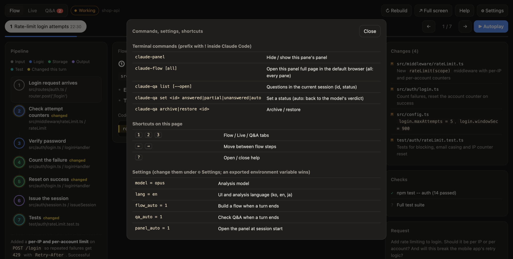

# Claude activity panel

[English](README.md) | [한국어](README.ko.md) | **日本語**

**自分の質問に Claude はすべて答えたか? そして実際に何を変えたのか?**

長いコーディングセッションでは、質問が何ページもの出力に埋もれてしまい、「完了しました」という一言だけでは変更後のコードがどう動くのか分かりにくくなります。このパネルは [cmux](https://cmux.dev) や Orca 上の [Claude Code](https://claude.com/claude-code) ペインの横に表示され、ターンごとにこの二つに答えます。

- **Q&A チェック**: 1 ターンで送った質問と依頼をすべて抽出します。Claude の作業中に送ったメッセージも含みます。Claude が実際に言ったこと・行ったことと照らし合わせて「回答済み / 一部 / 未回答」を判定し、足りない部分をハイライトします。未回答の項目は、後のターンで答えられると再チェックして更新します。状態の変更やアーカイブは、ページ上でも `claude-qa` コマンドでもできます。
- **ロジックフロー**: ファイルを編集したターンが終わると、変更された機能を実行順に展開して見せます。ステップごとのパイプライン、各ステップの役割と変更点、変更行をハイライトした実際のコード抜粋、変更ファイル、実行された検証が含まれます。
- **リアルタイム**: Claude が使うツール (実行中、成功、失敗、所要時間) と編集したファイルをその場で表示します。

パネルの画面と分析結果は英語、韓国語、日本語に対応しています。

## 画面

*架空のプロジェクトで作ったサンプルデータです。*

**Q&A チェック**: 質問ごとの状態、短い回答の要約、足りない部分のハイライト。


**ロジックフロー**: 変更された機能を実行順に展開したステップ、実際のコードと変更行のハイライト。具体的な例を一つ全ステップで追跡し、状態パネルが現在のステップまでの値を表示して、このステップで変わった値を強調します。これらの値は実行時に取得したものではなく、モデルがコードから推定したものです。


**リアルタイム**: 実行中のツールと編集したファイル。


**設定** (⚙) と **ヘルプ** (`?`)。




## 仕組み

```
Claude Code hooks ──► record.sh ──► logs/<pane>.jsonl ──┐
   (ツール呼び出し、依頼、ターン終了)                   ├─► server.py (127.0.0.1:47821) ──► ブラウザペインの app.html
Stop hook ──► flow.py / qa.py ──► flows/, qa/ (JSON) ───┘
                 └─ headless `claude -p` (読み取り専用ツール、MCP/hook/CLAUDE.md なし)
```

- リアルタイム表示にコストはかかりません。hook が JSON を 1 行ずつ記録し、ページがローカルサーバーを 1 秒ごとに読みます。
- フローと Q&A はターン終了後に別プロセスで動く headless `claude -p` なので、作業中のセッションのコンテキストには影響しません。フローはファイルを編集したターンでのみ動き、Read/Grep/Glob でコードを読めます。Q&A は会話テキストだけを見ます。
- パネルのキーは cmux のパネル id、なければ Orca の pane キー、なければセッション id です。Q&A はセッションごとに保存され、現在のセッションだけを表示します。
- cmux ではペインの右側にブラウザ split として開きます。Orca ではブラウザタブとして開きます (Orca にはブラウザ split がありません)。

## 必要なもの

macOS、Claude Code、`jq`、`curl`、`/usr/bin/python3` (3.9 以上、標準ライブラリのみ。`xcode-select --install` で入ります)、zsh、そして cmux または Orca。

## インストール

```sh
git clone <このリポジトリ> ~/.claude/activity-panel
~/.claude/activity-panel/install.sh
```

`install.sh` は `~/.claude/settings.json` に hook を追加し (変更がある場合のみ、横にバックアップを残します)、`~/.zshrc` に目印付きのブロックを追記し、`claude-panel`、`claude-flow`、`claude-qa`、`claude-activity` を `~/.local/bin` に置きます。再実行しても何も変わりません。

## コマンド

ターミナルで実行するか、Claude Code 内では先頭に `!` を付けて実行します (例: `! claude-panel`)。

| コマンド | 内容 |
|---|---|
| `claude-panel` | このペインのサイドパネルを表示 / 非表示 |
| `claude-flow` / `claude-flow all` | このペイン / 全ペインの一覧を既定のブラウザで全画面表示 |
| `claude-qa list [--open]` | 現在のセッションの質問を id と状態付きで表示 |
| `claude-qa set <id> answered\|partial\|unanswered\|auto` | 状態を手動で指定 (`auto` でモデルの判定に戻す) |
| `claude-qa archive <id>` / `restore <id>` | 項目をアーカイブ / 復元 |
| `claude-activity` | リアルタイム表示をこのペインのターミナル UI で見る |

パネル内のショートカット: `1` `2` `3` でフロー、リアルタイム、Q&A タブを切り替え、`←` `→` でフローのステップを移動、`?` で全コマンドと設定をまとめたヘルプを開きます。

## 設定

パネル右上の **⚙ 設定** から変更します。`~/.claude/activity-panel/config.json` に保存され、次の分析からすぐに反映されます。再起動は不要です。

**適用範囲** で **すべてのパネル** を選ぶと既定値が変わり、**このパネルのみ** を選ぶとこのパネル (とその中で動く Claude セッション) だけ上書きします。たとえば一つのパネルは日本語、別のパネルは韓国語にできます。パネルごとの値は設定画面に表示され、全体の設定に戻せます。

| 設定 | 既定値 | 意味 |
|---|---|---|
| 分析モデル | `opus` | フローと Q&A の分析モデル (`opus`、`sonnet`、`haiku` またはフルのモデル id) |
| 言語 | `en` | パネル画面と分析結果の言語: English、한국어、日本語 |
| フローを自動作成 | オン | オフにすると ↻ ボタンでのみ作成 |
| Q&A を自動チェック | オン | オフにすると ↻ ボタンでのみチェック |
| セッション開始時にパネルを開く | オン | オフにすると `claude-panel` でのみ開く |

環境変数は `CLAUDE_PANEL_PORT` (既定 `47821`) だけです。

## よくある質問

**Claude を追加で何回呼び出しますか?**
ターン終了ごとに最大 2 回です。Q&A チェックが毎ターン 1 回、そのターンでファイルを編集していればロジックフローがさらに 1 回動きます。リアルタイム表示、状態変更、アーカイブは呼び出しません。`!` のシェルコマンドはターンではないので何も動きません。↻ ボタンは押すたびに 1 回です。

**コストはどのくらいですか?**
実測値: Q&A チェックは Opus で $0.04 ~ $0.11、ロジックフローは Sonnet で $0.16 ~ $0.17 (Opus は未計測)。フローは読むコードが多いほど高くなります。これは Claude Code が表示する定価ベースの見積もりで、サブスクリプションでは代わりに利用上限にカウントされると思われますが、確認はしていません。抑えたい場合はモデルを `sonnet` や `haiku` に変えるか、自動実行をオフにしてください。

**Claude は毎回 HTML を作るのですか?**
いいえ。ページのテンプレートは一つだけです。分析は JSON を返し、ページがそれを描画します。

**↻ 作り直す / ↻ 再チェックはエージェント呼び出しですか?**
はい。自動実行と同じ headless `claude -p` を起動し、コストも同じです。ファイルを読むことしかできず、編集やコマンドの実行はできません。

**作業中のセッションが遅くなったり、コンテキストが増えたりしますか?**
いいえ。分析はターン終了後に別プロセスで動き、セッションのコンテキストには何も追加しません。

**ロジックフローはコードのロジックにも使えますか?**
それが目的です。変更された機能を実行ステップとして展開し、現在のファイルから実際のコードを抜粋して見せます。ファイルを編集したターンでのみ自動で動き、説明だけのターンでは ↻ を押してください。

**後のターンで答えたのに、まだ「一部」と表示されます。**
各ターンはそのターンの回答で判定されます。ターンが終わると、同じセッションの以前のターンで未回答の項目 (最大 20 件) をそのターンと照らし合わせ、答えられていれば更新します。それより古い項目は、そのターンの「↻ 後の回答も含めてチェック」を押すか、状態を手動で変更してください。

**パネルを隠したり、オフにしたりするには?**
`claude-panel` で表示 / 非表示を切り替えます。自動で開かないようにするには「セッション開始時にパネルを開く」をオフにします。削除するには `uninstall.sh` を実行します (`--purge` を付けると記録と設定も消えます)。

**データはどこに保存されますか?**
`~/.claude/activity-panel/` の下です: `config.json` (設定)、`logs/` (ツールの活動)、`flows/` (ロジックフロー)、`qa/<ペイン>/<セッション>/` (Q&A、セッションごとに保存)、`qa/<ペイン>/overrides.json` (手動で変えた状態)。どれも git にはコミットされません。ペインのページは `http://127.0.0.1:47821/p/<ペイン>`、全ペインの一覧は `http://127.0.0.1:47821/` です。

## データとプライバシー

すべてのデータは自分のマシン内に、自分のユーザーだけが読めるファイルとして保存されます。サーバーは 127.0.0.1 でのみ待ち受け、`127.0.0.1` か `localhost` 宛てのリクエストだけを受け付け (Web ページから DNS rebinding で到達できません)、POST リクエストには `X-Claude-Panel` ヘッダーが必要なので、他の Web ページが設定を変えたり有料の分析を実行させたりはできません。

## アンインストール

```sh
~/.claude/activity-panel/uninstall.sh          # 記録したデータと設定は残す
~/.claude/activity-panel/uninstall.sh --purge  # それも削除
```

## 未確認の点

Orca 経路 (`orca tab create`) は最初から最後まで実行して確認していません。

## ライセンス

[MIT](LICENSE)
