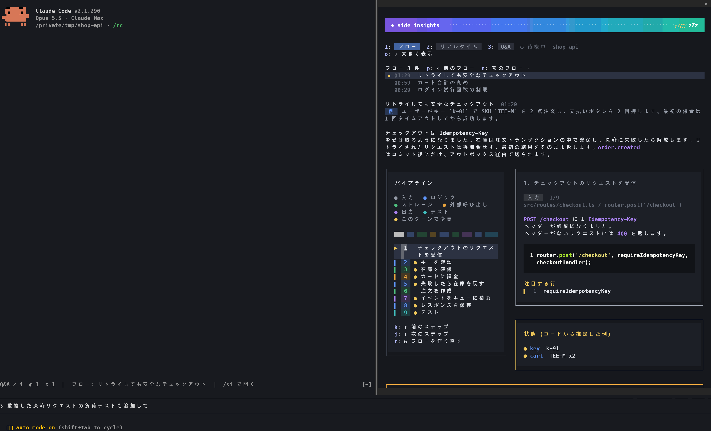
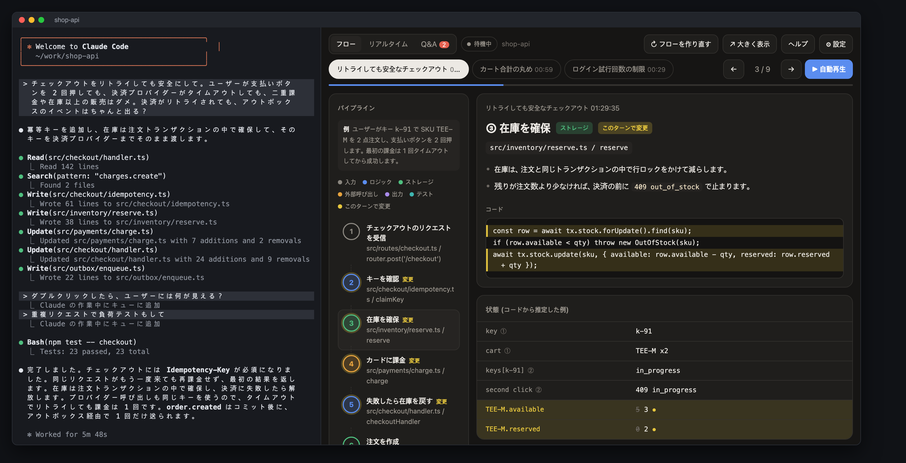
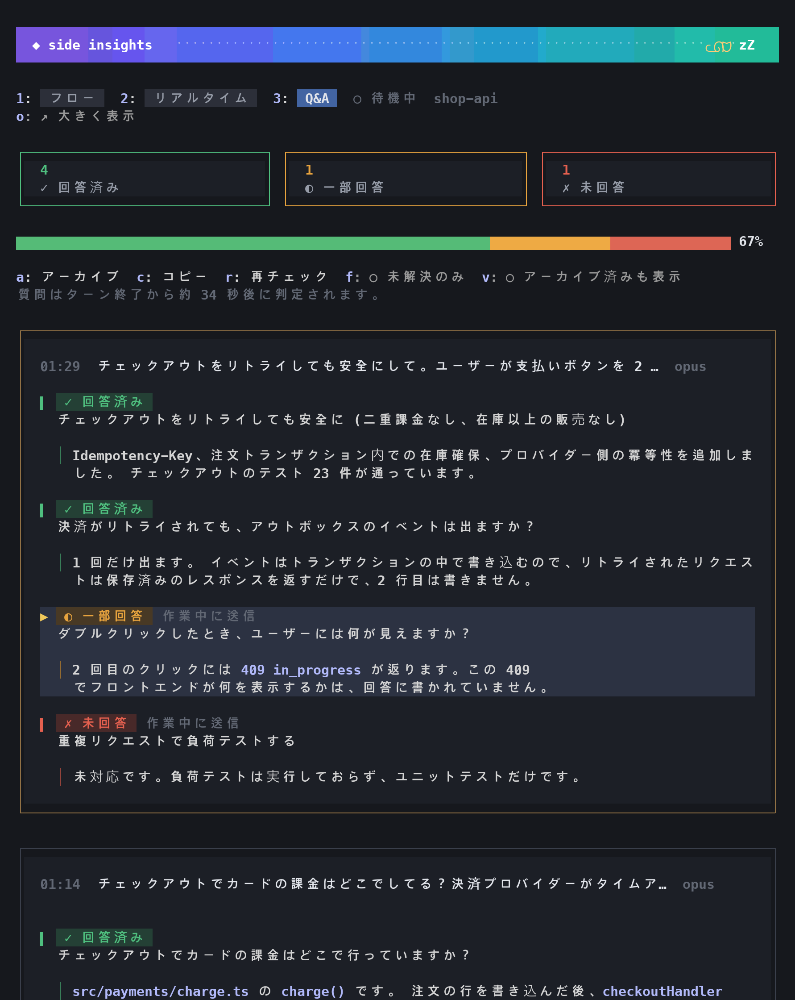
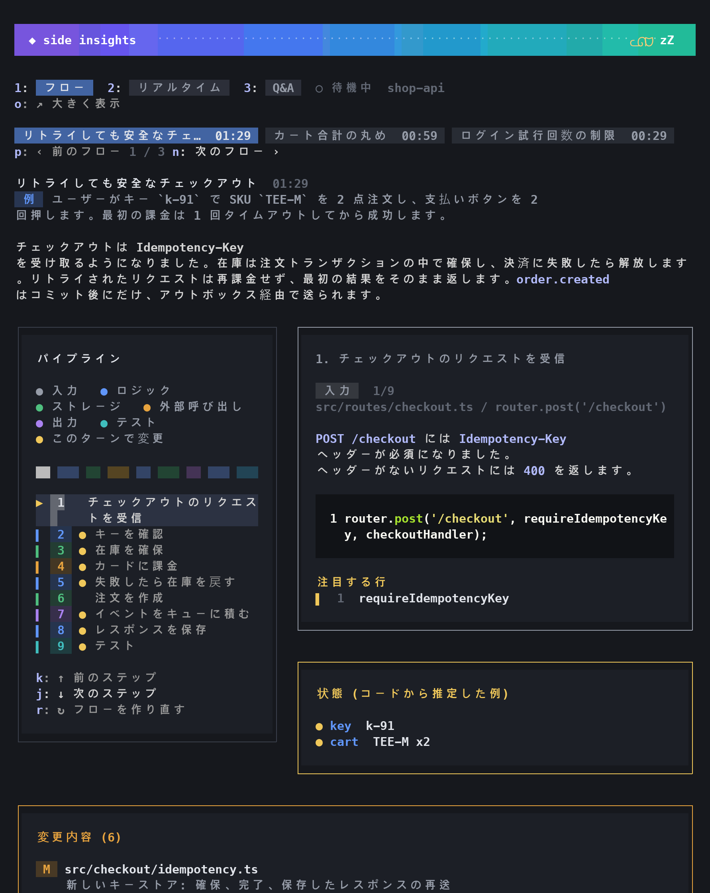
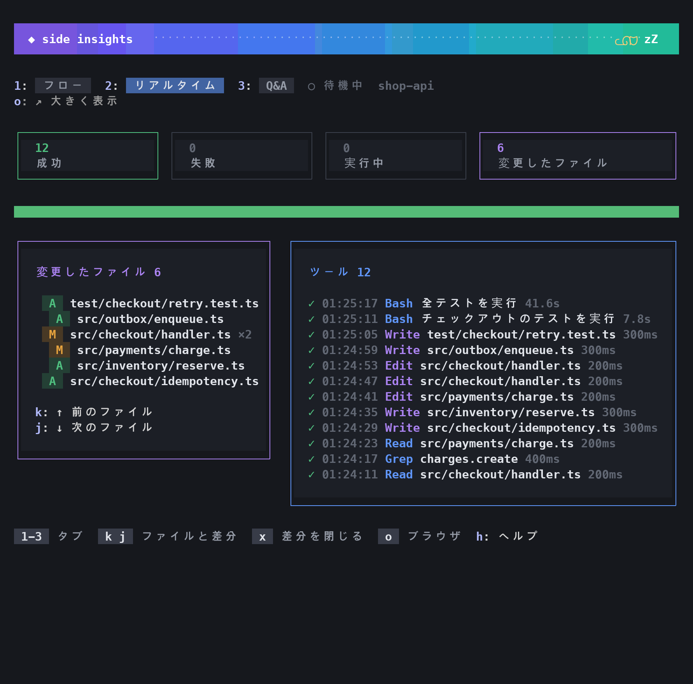
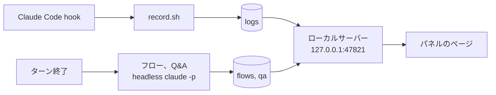

# Claude Side Insights

[English](README.md) | [한국어](README.ko.md) | **日本語**

## インストール

macOS、Linux、Windows で動きます。必要なら先に Python を用意してください: [必要なものと設定](#必要なものと設定)。

Claude Code の中で:

```
/plugin marketplace add wonjoonSeol-WS/claude-side-insights
/plugin install side-insights@claude-side-insights
/reload-plugins
```

次に Claude Code の中でパネルを開きます。セッションの横のパネルか、ブラウザかを選べます:

```
/si            # セッションの横のパネル
/si-browser    # ブラウザで全体パネル
```

パネルは `ctrl+x x` で閉じます。cmux では `/si-browser` がブラウザの分割ペインで開き、もう一度実行すると隠れます。それ以外では既定のブラウザで開きます。

更新:

```
/plugin marketplace update claude-side-insights
/plugin update side-insights@claude-side-insights
```

`/plugin` > Marketplaces で自動更新をオンにすることもできます。

## 表示されるもの

| `/si` パネル、どのターミナルでも | ブラウザパネル、`/si-browser` |
|---|---|
|  |  |



| フロー | リアルタイム |
|---|---|
|  |  |
| **狭いペイン** | **ヘルプ (`h`)** |
|  |  |

**Claude は質問に全部答えた? 何を変えた? 今何をしている?**

[Claude Code](https://claude.com/claude-code) のペインの横に表示されるパネルです。ターンが終わるたびに更新されます。

| タブ | 表示されるもの |
|---|---|
| **Q&A** | 送ったすべての質問 (作業中に送ったものも): ✓ 回答済み、◐ 一部回答、✗ 未回答。足りない部分をハイライトします。**⧉ 質問をコピー** は、その質問をもう一度聞くメッセージをコピーします。そのまま貼り付けられます。 |
| **フロー** | ファイルを変えたターンの後に (編集、またはファイルを書き込むシェルコマンド): 変わった機能をステップごとに、実際のコードと変更行のハイライト付きで。 |
| **リアルタイム** | 実行中のツール呼び出しと、変更されたファイル。 |

> [!WARNING]
> **フローはデバッガーではありません。** ターンの後、モデルが変更されたコードと会話を読んで書きます。実行も追跡もしないため、ステップ、例、値が間違っていたり作り話だったりすることがあります。頼る前に実際のコードを確認してください。

English、한국어、日本語に対応しています。

## 画面

*架空のプロジェクトで作った例です。*

**ブラウザパネル**: `/si-browser` で開きます。cmux ではブラウザの分割ペイン、それ以外では既定のブラウザで開きます。

| Q&A | フロー |
|---|---|
|  |  |
| **リアルタイム** | **設定** |
|  |  |

フロータブは一つの例をすべてのステップで追います。値はコードから推定したもので、実行時に取得したものではありません。

**ターミナルパネル**: iTerm2、Ghostty、Orca では `! si-panel` で従来のターミナルパネルも分割ペインで開けます。タブは同じ三つです。

## 対応ターミナル

`/si` は Claude Code が動くすべてのターミナルで使えます。`! si-panel` (cmux では `/si-browser` も) は次のターミナルで Claude の横にパネルを開きます。

| ターミナル | Claude の横に開くもの | テスト |
|---|---|---|
| [cmux](https://cmux.dev) | パネル全体 (ブラウザ split) | 済み |
| Orca | ターミナルパネル (split) | 済み |
| Ghostty 1.3 以上 | ターミナルパネル (split) | 済み |
| iTerm2 | ターミナルパネル (split) | 済み |
| その他 | `! si-panel` でパネル全体をブラウザで開きます (隠すことはできません)。`/si` はどこでも使えます | 済み |

- ターミナルパネルにもフロー、リアルタイム、Q&A の三つのタブがあります。`! si-open` はブラウザ版を開きます。
- Ghostty と iTerm2 は AppleScript で操作します。最初に一度だけ macOS が許可を求めます。
- ターミナルの追加はシェルファイル一つです。[terminals/README.md](terminals/README.md) を参照。

## /si パネル

Claude Code 2.1.287 以降が必要です (2.1.296 でテスト)。Claude Code 自身が描くので、どのターミナルでも同じ見た目です。キーを使う前に `ctrl+x tab` (またはクリック) でキー入力をパネルに移してください。パネルで使わない英字や数字を押すと、プロンプトに流れず案内が出ます。日本語入力がオンのときはキーが効かないので、英字入力に切り替えてください。ショートカットは英字と数字だけを受け付けます。Q&A では質問をクリックして選びます (または Tab で移動して Enter)。選ぶと質問全体がコピーされます。最初は一つ目の未解決の質問が選ばれています。

| キー | 動作 |
|---|---|
| `/si` (または `/side-insights`) | パネルを開く。Claude がターンを実行中でも開けます |
| `/si-browser` | ブラウザパネルを表示 / 非表示。cmux では分割ペイン、それ以外では既定のブラウザ |
| `1` `2` `3` | フロー、リアルタイム、Q&A |
| `p` `n` | フロー: 新しい / 古いフロー (フローのタイトルのクリックでも可) |
| `k` `j` | フロー: 前 / 次のステップ。リアルタイム: 前 / 次の変更ファイルとその差分 |
| `d` `s` `f` | 差分を開いているとき: コミット前の変更、そのファイルを最後に変えたコミット、ファイル全体 |
| `x` | 差分を閉じる (`git diff`、新しいファイル、またはそのファイルを最後に変えたコミット) |
| `u` | 今すぐチェック。フロー: 最後のターンのフローを作る。Q&A: まだチェックしていないターンをすべてチェックし、未解決の質問を再チェック。リアルタイム: 更新。フローと Q&A では 2 回押すと実行され、それぞれ Claude を 1 回呼び出します |
| `r` | フロー: フローを作り直す。Q&A: 選んだ質問 (または失敗したターン) を再チェック。2 回押すと実行され、Claude を 1 回呼び出します |
| `a` `c` | Q&A: 選んだ質問をアーカイブ / 戻す。まだ未解決ならコピー |
| `f` `v` | Q&A: 未解決のみ表示、アーカイブを表示 |
| `m` | Q&A: 選んだ質問をした位置まで会話をスクロールします。回答の行をクリックしても同じです。/si パネルだけで使え、消えたり圧縮されたりした会話には移動できません |
| `o` | ブラウザで大きく表示 |
| `g` | 設定: このパネルを分析、分析するセッション、自動実行、言語、モデル、セッション開始時にパネルを開く、テーマ。`k` `j` で設定を選び、`p` `n` で値を変えます。`g` で閉じます |
| `h` | すべてのキー (Claude Code 自身のパネルキーを含む) |
| `ctrl+x ←` `ctrl+x →` | 広く / 狭く (プロンプトの上では `↑` `↓`)。区切り線のドラッグでも変えられます |

ほかに:

- リアルタイムと Q&A では件数のタイルを押すと、そのツール呼び出しや質問だけを表示します。もう一度押すと解除します。
- フローのステップや変更内容カードで変更ファイルをクリックしても差分が開きます。
- 幅が 78 桁以上になると、フローとリアルタイムが二列になります。
- プロンプトの上の一行に Q&A の件数、待っている質問、最新のフローが出ます。
- スピナーに待っている質問の数が付きます。
- 新しいフローができたとき、またはチェック後に未解決の質問が残ったときに短い通知が出ます。
- ほかのパネルと同じローカルサーバーから読み、止まっていれば起動します。

## 必要なものと設定

Claude Code 2.1.275 以上 (`/si` と `/si-browser` は 2.1.287 以上) と Python 3.9 以上が必要です。`jq` も入れておくのがおすすめです。プラグインはツール呼び出しごとに小さな hook を実行し、`jq` があると速く、なければ Python で代わりに動きます。Orca の分割表示には `jq` が必要です。

### macOS

1. Python: macOS に入っているものを使います。`python3 --version` が開発ツールのインストールを求めたら `xcode-select --install` を実行してください。
2. [インストール](#インストール) のとおりにプラグインを入れます。
3. `jq`: macOS 15 以降には最初から入っています。それより古い macOS は `brew install jq`。

すべての機能が使えます。`/si`、`/si-browser`、ターミナルパネル、そして cmux、Orca、Ghostty、iTerm2 で Claude の横に開くパネルまで。

### Linux

1. Python 3.9+: たいてい入っています。なければ `sudo apt install python3` (Debian、Ubuntu) か `sudo dnf install python3` (Fedora)。
2. [インストール](#インストール) のとおりにプラグインを入れます。
3. `jq`: `sudo apt install jq` (Debian、Ubuntu) か `sudo dnf install jq` (Fedora)。
4. 任意: コピーボタン用に `wl-clipboard` (Wayland) か `xclip` (X11)。

`/si`、`/si-browser` (既定のブラウザ)、ターミナルパネル (`si-activity`、別のターミナルで実行) が使えます。Claude の横にパネルが開くのは Orca だけです。

### Windows

Claude Code はプラグインの hook を Git for Windows に含まれる Git Bash で実行します。

1. Git for Windows (Claude Code にも必要です): `winget install Git.Git`。
2. Python 3.9+: `winget install Python.Python.3.12`、または python.org のインストーラー。Microsoft Store を開く `python3` コマンドはただのショートカットなので、プラグインはそれを飛ばして `python` か `py` を使います。
3. [インストール](#インストール) のとおりにプラグインを入れ、Claude Code を再起動します。
4. `jq`: `winget install jqlang.jq` のあと Claude Code を再起動すると Git Bash から見えるようになります。

`/si` と `/si-browser` (既定のブラウザ) が使えます。ターミナルパネルと Claude の横に開くパネルは Windows では使えません。Git を変わった場所に入れた場合は、`CLAUDE_CODE_GIT_BASH_PATH` にその `bash.exe` を設定してください。Claude Code も同じ変数を使います。

### 設定の確認

Claude Code の中で `! si-panel` を実行してください。足りないものがあれば `side-insights needs: Python 3.9+` のように表示します。

## コマンド

Claude Code の中で先頭に `!` を付けて実行します (`si-activity` を除く)。例: `! si-panel`

| コマンド | 役割 |
|---|---|
| `si-panel` | このペインのパネルを表示 / 非表示 (分割ペインを開けないターミナルではブラウザのページを開きます) |
| `si-open` | パネル全体をブラウザで開く (`all` で全ペインの一覧) |
| `si-qa list [--open]` | このセッションの質問の一覧 |
| `si-qa set <id> answered\|partial\|unanswered\|auto` | 状態を手動で変更 |
| `si-qa archive <id>` / `restore <id>` | 項目を隠す / 戻す |
| `si-activity` | リアルタイムの活動をターミナル画面で。`!` の後ではなく、別のターミナルペインで実行します |

ブラウザパネルのキー:

- `1` `2` `3`: フロー、リアルタイム、Q&A
- `←` `→`、フローでは `k` `j` も: ステップ移動。`p` `n`: 新しい / 古いフロー
- リアルタイムの `k` `j`: 前 / 次の編集ファイルとその差分。`d` `s` `f` で表示を切り替え、`x` で閉じます
- `?`: ヘルプ、`Esc`: ダイアログを閉じる

リアルタイムやフローで変更ファイルをクリックすると、/si と同じ表示 (コミット前の変更、最後のコミット、ファイル全体) で差分を見られます。リアルタイムと Q&A の数字タイルを押すと一覧が絞り込まれ、質問をクリックするとコピーされます。

ターミナルパネルでは `h` ですべてのキーを表示します。Q&A では `↑` `↓` で質問を選び、`s` で状態変更、`a` でアーカイブ、`c` で選んだ質問をコピー、`r` で再チェック (2 回押す)。`R` は未解決の質問をまとめて再チェックします (これも 2 回押す)。フローでは `[` `]` でフローを切り替え、`p` でステップを自動で進めます。

## 設定

- ブラウザパネルの **⚙ 設定** か、/si の `g` で開きます。次の分析から反映され、再起動は不要です。言語を変えるとページを読み込み直します。
- **このパネルを分析** だけが今いるパネルの設定です。ほかはすべてのパネルで共通なので、どのパネルで見ても同じ値です。
- 保存先: `~/.claude/side-insights/config.json`

| 設定 | 既定値 | 意味 |
|---|---|---|
| このパネルを分析 | ここで `/si` を開くまでオフ | `/si` か `/si-browser` を開くとオンになり、`/si` パネルを自分で閉じるとオフになります。オンの間は、このパネルでセッションが始まると `/si` が自動で開きます |
| 分析するセッション | /si で開いたパネルだけ | **すべてのセッション** にすると、開いたかどうかに関係なくすべてのセッションを分析します。どのパネルで変えても全体に効きます |
| ターン終了時にフローを作成 | オン | オフにすると今すぐチェック (`u`) か ↻ でのみ作成 |
| ターン終了時に Q&A をチェック | オン | オフにすると今すぐチェック (`u`) か ↻ を押すまでターンが待機のまま |
| 1 回のチェックで見るターン数 | 20 | 1 回のチェックが扱う待機中のターン数: 5、10、20、30。モデルを変えるとそのモデルの既定値 (Opus 20、Sonnet 10、Haiku 5) に戻り、そのあと変えることもできる。大きいほど呼び出し回数は減るが 1 回が大きくなり、小さいモデルほど判定の精度が落ちる |
| 分析モデル | `opus` | `opus`、`sonnet`、`haiku` (完全なモデル id は config.json で指定) |
| 言語 (画面と分析) | システムの言語が韓国語か日本語ならその言語、それ以外は `en` | English、한국어、日本語 |
| セッション開始時にパネルを開く | オン | cmux、Orca、Ghostty、iTerm2 で、分析中のパネル (**すべてのセッション** ならどのパネルでも) でセッションが始まるとパネルが自動で開く |
| /si パネルのテーマ | Claude Code に合わせる | Claude Code に合わせる、ダーク、ライト |

「パネル」は cmux、Orca、iTerm2 ではターミナルのペインなので、そこではセッションが変わっても保たれます。それ以外では Claude Code のセッション 1 つで、そのセッションを再開すると `/si` も開き直します。

環境変数: `SIDE_INSIGHTS_PORT` (既定 `47821`) と `SIDE_INSIGHTS_DATA` (既定 `~/.claude/side-insights`)。

## よくある質問

**Claude の呼び出しはいつ増えますか? 使用量は2倍になりますか?**

いいえ。既定では `/si` を開いたセッションだけを分析し、パネルを閉じると止まります。ターンが終わるたびに Claude の呼び出しが最大2回増え、自分のセッションの外で別の `claude -p` として実行されます。

| いつ | 何を | 追加の呼び出し | 条件 |
|---|---|---|---|
| ターン終了時 | Q&A チェック | 1回 (ツールなし、リクエスト1回) | このパネルを分析中 (またはすべてのセッション) で、「ターン終了時に Q&A をチェック」がオンのとき |
| ターン終了時 | フロー | 1回 (読み取り専用ツールを使うため内部で複数回リクエスト) | 上と同じで、そのターンでファイルが変わり (編集、またはファイルを書くシェルコマンド)、「ターン終了時にフローを作成」がオンのとき |
| `/si` か `/si-browser` を開いてパネルをオンにしたとき | 最近のターン (既定 20) の Q&A、最後のターンのフロー | 最大2回 | セッションにすでにターンがあるとき。フローはそのターンがファイルを変えていて、まだフローがないときだけ |
| `u`、`r`、↻、**古いものをチェック** を押したとき | 今すぐチェック / 再チェック / 作り直し / 次の古いターンのまとまり | 押すたびに1回 | `/si` では `u` と `r` は2回押すと実行、ブラウザのボタンはすぐ実行 |
| `/si` パネル自体 | 画面、キー、差分、テーマ | 0回 | ローカルサーバーとだけ通信 |

1 回の Q&A チェックが扱うのは、まだチェックしていないターンのうち最近のものだけで、既定は 20 件までです (**1 回のチェックで見るターン数**: 5、10、20、30)。それより古いターンはそのターンのカードに飛ばした件数として表示され、**古いものをチェック** を押すたびに次のまとまりをチェックします。まとまりごとにカードが分かれます。

あるターンが前のフローの変更を続けている (同じ機能を整える、直す、広げる) ときは、新しいフローが前のフローに置き換わって両方のターンを扱います。そのため一覧にはほぼ同じフローが並ばず、最新のフローが 1 つ残ります。

作業するターンはそれだけで普通は数十回のモデルリクエストを行うので、その後の分析1〜2回の比重は小さいです。ツールを使わない短いやり取りが多いと、そのたびに Q&A チェックが付くので比重が大きくなります。

そのため、すべてオンにしても使用量が3倍になることはありません。すべてオン、既定の Opus での測定例: 分析288回で合計約 $24 でした (Q&A 1回あたり約 $0.06、フロー1回あたり約 $0.17)。同じマシンでの長い作業セッション1つはモデルリクエストが約1,850回で、トークン数から見ると Opus の定価で約 $500 です。分析288回をすべて合わせても、そのセッション1つの5%ほどでした。

**コスト** (Claude Code の定価ベースの見積もり)

| 内容 | Claude 呼び出し | コスト |
|---|---|---|
| リアルタイム画面、状態変更、アーカイブ | 0 | 無料 |
| Q&A チェック、毎ターン | 1 | Opus で $0.04 から $0.11 |
| フロー、ファイルを変えたターンのみ | 1 | $0.16 から $0.17 (Sonnet で測定。既定の Opus はもっと高くなります) |
| ↻ ボタン 1 回 | 1 | 上と同じ |

サブスクリプションでは利用上限から差し引かれる可能性が高いです (未確認)。抑えるには `sonnet` か `haiku` を選ぶか、⚙ 設定で自動実行をオフにします。

**よくある質問**

| 質問 | 答え |
|---|---|
| セッションが遅くなったり、コンテキストを使ったりしますか? | いいえ。ターン終了後に別プロセスで動きます。 |
| ↻ の実行がファイルを変えることはありますか? | いいえ。読み取り専用のツールだけを使います。 |
| このターンにフローがありません | ファイルを変えたターンだけ、しかも分析中のパネルでだけ自動で作ります。フロータブで **↻ 今すぐチェック** (`u`) を押してください。 |
| 後で答えたのに未解決のままです | たいてい次のチェックで直ります。直らなければ **↻ 未解決を再チェック** か **↻ この質問を再チェック** (/si では `r`) を押すか、ブラウザパネルで状態を直接クリックします。チェックに失敗したターンには **↻ このターンを再チェック** が出ます。 |
| パネルを隠すには? | `/si` パネルを `ctrl+x x` で閉じます。これでこのパネルの分析も止まります。横のパネルは `! si-panel` で隠したり出したりします。 |
| 追加の呼び出しを止めるには? | `/si` パネルを閉じるか、**分析するセッション** を **/si で開いたパネルだけ** に戻してください。すべて止めるには 2 つの自動実行をオフにします。 |
| `/si-browser` が cmux の分割ではなくブラウザを開きます | セッションが cmux の外 (たとえばバックグラウンドジョブ) で動いています。cmux は自分の中で起動したプロセスからのコマンドしか受け付けないため、既定のブラウザで代わりに開きます。cmux のターミナルで Claude Code を起動すると分割で開きます。 |

**データの場所**: `~/.claude/side-insights/`

| パス | 内容 |
|---|---|
| `config.json` | 設定 |
| `token` | ページと `si-qa` が使う秘密の値 |
| `logs/` | ツールの活動 |
| `turns/` | ペインごとに最後に終わったターンの transcript とフォルダ |
| `flows/` | フロー |
| `qa/<ペイン>/<セッション>/` | Q&A、セッションごと |
| `qa/<ペイン>/overrides.json` | 手動で変えた状態とアーカイブした質問 |
| `terminals/` | 開いている Orca パネルのハンドル |
| `server.log`、`analysis.log` | ローカルサーバーとフロー、Q&A の実行ログ |

## 仕組み



- リアルタイム画面: hook がイベントごとに 1 行記録します。費用はかかりません。
- フローと Q&A: ターン終了後に別の `claude -p` で動きます。読み取り専用のツールだけを使い、MCP と hook はありません。作業中のセッションのコンテキストには触れません。
- フローはファイルを変えたターンだけで動きます。編集、またはファイルを書き込むシェルコマンドがあったターンです。Q&A は会話とツールの一覧だけを読み、ファイルは読みません。
- パネルはターミナルのペイン id、なければセッション id で区別します。

## データとプライバシー

- データはすべて `~/.claude/side-insights/` にあり、自分のアカウントだけが読めます。
- サーバーは 127.0.0.1 だけで待ち受け、ホストが `127.0.0.1` か `localhost` のリクエストだけを受け付けます (DNS rebinding 対策)。
- `/health` を除くすべてのページと API は秘密のトークンで守られています。トークンは自動で作られ、`si-panel` と `si-open` が開くリンクに自動で付くので、自分で入力することはありません。ほかの Web ページや同じマシンのほかのユーザーはトークンを持たないため、記録を読んだり有料の分析を実行したりできません。`si-panel` が表示するリンクにはトークンが含まれ、セッションの記録にも残るので、パスワードと同じように扱ってください。`/si-browser` はリンクを表示しません。
- トークンがあれば、差分表示でセッションの作業フォルダ以下のファイルと、セッションが編集したファイルを見られます。

## アンインストール

```
/plugin uninstall side-insights@claude-side-insights
```

記録したデータは `~/.claude/side-insights/` に残ります。消すにはそのフォルダを削除してください。ローカルサーバーは Mac を再起動すると止まります。すぐ止めるには `pkill -f 'side_insights server'` を実行してください。

**以前の `install.sh` 版を使っていた場合**は、残ったものを一度だけ消してください。`~/.claude/settings.json` で `~/.claude/activity-panel/record.sh` か `open-panel.sh` を指す hook、`~/.zshrc` の `claude-activity-panel` ブロック、`~/.local/bin` の `claude-panel`、`claude-flow`、`claude-qa`、`claude-activity` です。

## ライセンス

[MIT](LICENSE)
