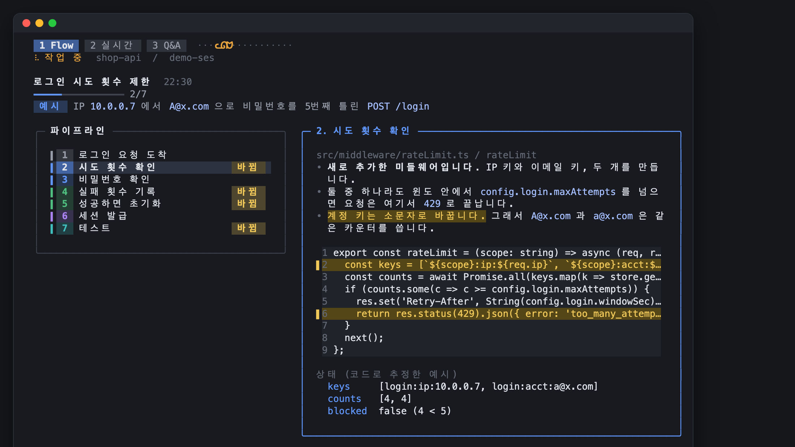
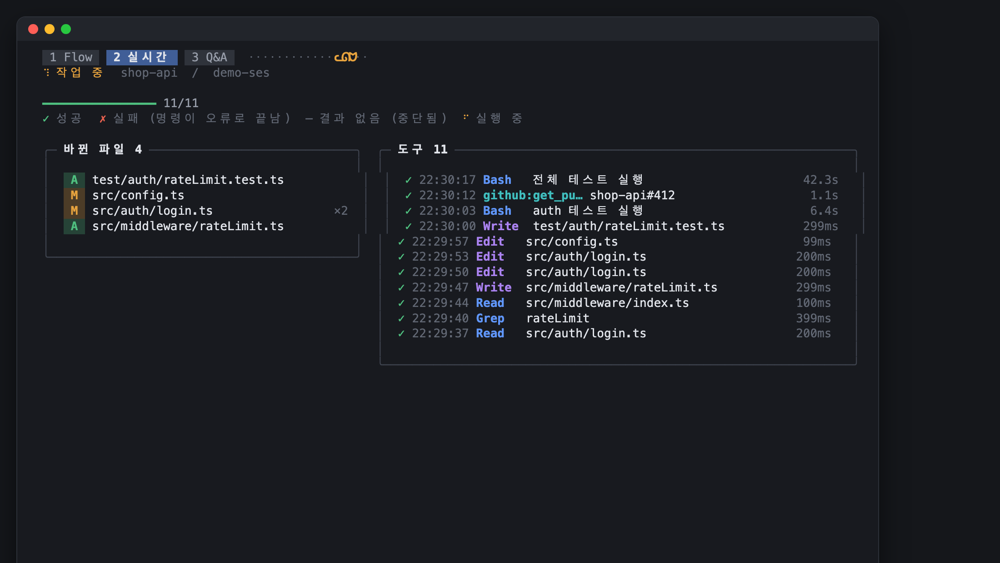
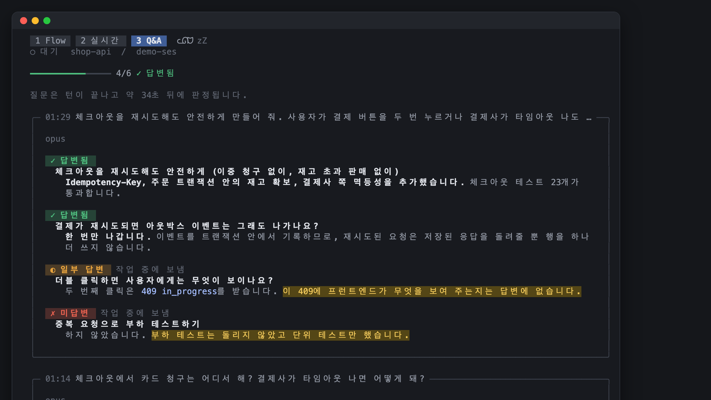
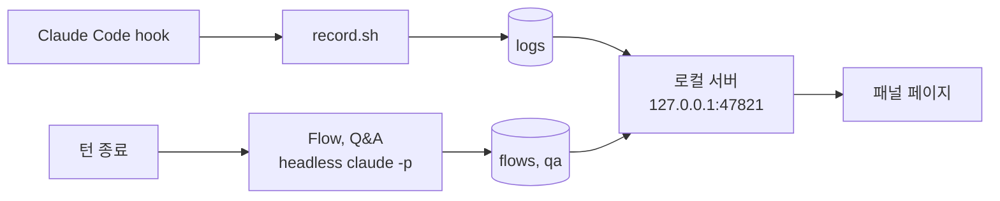

# Claude Side Insights

[English](README.md) | **한국어** | [日本語](README.ja.md)

## 설치

Claude Code 안에서:

```
/plugin marketplace add wonjoonSeol-WS/claude-side-insights
/plugin install side-insights@claude-side-insights
/reload-plugins
```

업데이트:

```
/plugin marketplace update claude-side-insights
/plugin update side-insights@claude-side-insights
```

`/plugin` > Marketplaces에서 자동 업데이트를 켜도 됩니다.

## 무엇을 보여 주나

**Claude가 내 질문에 다 답했나? 무엇을 바꿨나? 지금 뭘 하고 있나?**

[Claude Code](https://claude.com/claude-code) 창 옆에 붙는 패널입니다. 턴이 끝날 때마다 갱신됩니다.

| 탭 | 보이는 것 |
|---|---|
| **Q&A** | 내가 한 모든 질문 (작업 중에 보낸 것 포함): ✓ 답변됨, ◐ 일부 답변, ✗ 미답변. 빠진 부분을 강조합니다. **⧉ 질문 복사**로 다시 물어볼 수 있습니다. |
| **Flow** | 파일을 고친 턴 뒤에: 바뀐 기능을 단계별로, 실제 코드와 바뀐 줄 강조와 함께. |
| **실시간** | 도는 중인 도구 호출과 바뀐 파일. |

English, 한국어, 日本語를 지원합니다.

## 화면

*가상의 프로젝트로 만든 예시입니다.*

**브라우저 패널**: cmux처럼 브라우저를 지원하는 터미널, 또는 `claude-flow`로 연 브라우저에서 이렇게 보입니다.

| Q&A | Flow |
|---|---|
|  |  |
| **실시간** | **설정** |
|  |  |

Flow 탭은 예시 하나를 모든 단계에 따라가며 보여 줍니다. 값은 코드에서 추론한 것이고 실행 중에 잡은 값이 아닙니다.

**터미널 패널** (iTerm2, Ghostty, Orca): 같은 세 탭을 터미널에 그립니다.

| Flow | 실시간 | Q&A |
|---|---|---|
|  |  |  |

## 지원하는 터미널

| 터미널 | Claude 옆에 열리는 것 | 테스트 |
|---|---|---|
| [cmux](https://cmux.dev) | 전체 패널 (브라우저 split) | 함 |
| Orca | 터미널 패널 (split) | 함 |
| Ghostty 1.3 이상 | 터미널 패널 (split) | 함 |
| iTerm2 | 터미널 패널 (split) | 함 |
| 그 밖의 터미널 | 없음. 아래 명령을 쓰세요 | 함 |

- 터미널 패널에도 Flow, 실시간, Q&A 세 탭이 있습니다. `! claude-flow`는 브라우저 버전을 엽니다.
- Ghostty, iTerm2는 AppleScript로 조작합니다. 처음 한 번 macOS가 권한을 묻습니다.
- 터미널 추가는 셸 파일 하나면 됩니다. [terminals/README.md](terminals/README.md) 참고.

## 요구 사항

- macOS (`osascript`, `open`, 시스템 Python을 씁니다)
- Claude Code 2.1.275 이상
- `jq`, `curl`
- `/usr/bin/python3` 3.9 이상 (`xcode-select --install`)

## 명령

Claude Code 안에서 앞에 `!`를 붙여 실행합니다. 예: `! claude-panel`

| 명령 | 하는 일 |
|---|---|
| `claude-panel` | 이 창의 패널 보이기 / 숨기기 |
| `claude-flow` | 전체 패널을 브라우저로 열기 (`all`은 모든 창 목록) |
| `claude-qa list [--open]` | 이 세션의 질문 목록 |
| `claude-qa set <id> answered\|partial\|unanswered\|auto` | 상태 직접 바꾸기 |
| `claude-qa archive <id>` / `restore <id>` | 항목 숨기기 / 되돌리기 |
| `claude-activity` | 실시간 활동을 터미널 화면으로 |

패널 단축키:

- `1` `2` `3`: Flow, 실시간, Q&A
- `←` `→`: Flow 단계 이동
- `?`: 도움말, `Esc`: 닫기

## 설정

- 오른쪽 위 **⚙**로 엽니다. 다음 분석부터 바로 적용되고 재시작은 필요 없습니다.
- **적용 범위**: **모든 패널** 또는 **이 패널만** (예: 한 창은 일본어, 다른 창은 한국어).
- 저장 위치: `~/.claude/side-insights/config.json`

| 설정 | 기본값 | 설명 |
|---|---|---|
| 분석 모델 | `opus` | `opus`, `sonnet`, `haiku` (전체 모델 id는 config.json에서 지정) |
| 언어 (화면, 분석) | `en` | English, 한국어, 日本語 |
| 턴이 끝나면 Flow 만들기 | 켜짐 | 끄면 ↻ 버튼으로만 만듦 |
| 턴이 끝나면 Q&A 점검 | 켜짐 | 끄면 ↻ 버튼으로만 점검 |
| 세션이 시작되면 패널 열기 | 켜짐 | 끄면 `claude-panel`로만 열림 |

환경변수: `SIDE_INSIGHTS_PORT`(기본 `47821`), `SIDE_INSIGHTS_DATA`(기본 `~/.claude/side-insights`).

## 자주 묻는 질문

**비용** (Claude Code 정가 기준 추정)

| 무엇 | Claude 호출 | 비용 |
|---|---|---|
| 실시간 화면, 상태 변경, 보관 | 0 | 무료 |
| Q&A 점검, 매 턴 | 1 | Opus 기준 $0.04 ~ $0.11 |
| Flow, 파일을 고친 턴만 | 1 | Sonnet 기준 $0.16 ~ $0.17 |
| ↻ 버튼 한 번 | 1 | 위와 같음 |

구독 요금제라면 사용량 한도에서 차감될 가능성이 큽니다 (확인 안 됨). 줄이려면 모델을 `sonnet`이나 `haiku`로 바꾸거나 ⚙ 설정에서 자동 실행을 끄세요.

**자주 나오는 질문**

| 질문 | 답 |
|---|---|
| 세션이 느려지거나 컨텍스트를 쓰나요? | 아니요. 턴이 끝난 뒤 별도 프로세스로 돕니다. |
| ↻ 실행이 파일을 고칠 수 있나요? | 아니요. 읽기 전용 도구만 씁니다. |
| 이번 턴에 Flow가 없어요 | 파일을 고친 턴에만 자동으로 만듭니다. **↻ Flow 다시 만들기**를 누르세요. |
| 나중에 답했는데 미해결로 남아요 | 보통 다음 점검에서 풀립니다. 아니면 **↻ 미해결 다시 점검**, **↻ 이 질문 다시 점검**을 누르거나 상태를 직접 누르세요. 점검이 실패한 턴에는 **↻ 이 턴 다시 점검**이 나옵니다. |
| 패널을 숨기려면? | `! claude-panel`로 숨기고 다시 엽니다. 자동으로 열리지 않게 하려면 "세션이 시작되면 패널 열기"를 끄세요. |

**데이터 위치**: `~/.claude/side-insights/`

| 경로 | 내용 |
|---|---|
| `config.json` | 설정 |
| `token` | 페이지와 `claude-qa`가 쓰는 비밀값 |
| `logs/` | 도구 활동 |
| `turns/` | 창별로 마지막에 끝난 턴의 transcript와 폴더 |
| `flows/` | Flow |
| `qa/<창>/<세션>/` | Q&A, 세션별 |
| `qa/<창>/overrides.json` | 직접 바꾼 상태 |
| `terminals/` | 열려 있는 터미널 패널의 핸들 |
| `server.log`, `analysis.log` | 로컬 서버와 Flow, Q&A 실행 로그 |

## 동작 방식



- 실시간 화면: hook이 이벤트마다 한 줄씩 기록합니다. 비용 없음.
- Flow, Q&A: 턴이 끝난 뒤 별도의 `claude -p`로 돕니다. 읽기 전용 도구만 쓰고 MCP와 hook은 없습니다. 작업 중인 세션의 컨텍스트는 건드리지 않습니다.
- Flow는 파일을 고친 턴에만 돕니다. Q&A는 대화와 도구 목록만 읽고 파일은 읽지 않습니다.
- 패널은 터미널의 창 id로, 없으면 세션 id로 구분합니다.

## 데이터와 개인정보

- 모든 데이터는 `~/.claude/side-insights/`에 있고 내 계정만 읽을 수 있습니다.
- 서버는 127.0.0.1에서만 열리고, 호스트가 `127.0.0.1`이나 `localhost`인 요청만 받습니다 (DNS rebinding 차단).
- 모든 페이지와 API는 비밀 토큰으로 보호됩니다. 토큰은 자동으로 만들어지고 `claude-panel`, `claude-flow`가 여는 링크에 자동으로 붙으므로 직접 입력할 일은 없습니다. 다른 웹 페이지나 같은 컴퓨터의 다른 사용자는 토큰이 없어서 기록을 읽거나 유료 분석을 실행할 수 없습니다. `claude-panel`이 출력하는 링크에는 토큰이 들어 있고 세션 기록에도 남으니, 비밀번호처럼 다루세요.

## 제거

```
/plugin uninstall side-insights@claude-side-insights
```

기록한 데이터는 `~/.claude/side-insights/`에 남습니다. 지우려면 그 폴더를 삭제하세요. 로컬 서버는 Mac을 다시 시작하면 꺼지고, 바로 끄려면 `pkill -f 'side_insights server'`를 실행하세요.

**예전 `install.sh` 버전을 쓰셨다면** 남은 것을 한 번 지워 주세요. `~/.claude/settings.json`에서 `~/.claude/activity-panel/record.sh`나 `open-panel.sh`를 가리키는 hook, `~/.zshrc`의 `claude-activity-panel` 블록, `~/.local/bin`의 `claude-panel`, `claude-flow`, `claude-qa`, `claude-activity`입니다.

## 라이선스

[MIT](LICENSE)
