# Claude Side Insights

[English](README.md) | **한국어** | [日本語](README.ja.md)

## 설치

macOS, Linux, Windows에서 동작합니다. 필요하면 먼저 Python을 준비하세요: [요구 사항과 설정](#요구-사항과-설정).

Claude Code 안에서:

```
/plugin marketplace add wonjoonSeol-WS/claude-side-insights
/plugin install side-insights@claude-side-insights
/reload-plugins
```

그다음 Claude Code 안에서 패널을 엽니다. 세션 옆 패널이나 브라우저 중 고르면 됩니다:

```
/si            # 세션 옆 패널
/si-browser    # 브라우저에서 전체 패널
```

패널은 `ctrl+x x`로 닫습니다. cmux에서 `/si-browser`는 브라우저 분할 창으로 열리고, 한 번 더 실행하면 숨겨집니다. 그 밖에서는 기본 브라우저로 열립니다.

업데이트:

```
/plugin marketplace update claude-side-insights
/plugin update side-insights@claude-side-insights
```

`/plugin` > Marketplaces에서 자동 업데이트를 켜도 됩니다.

## 보여 주는 것

| `/si` 패널, 모든 터미널 | 브라우저 패널, `/si-browser` |
|---|---|
| 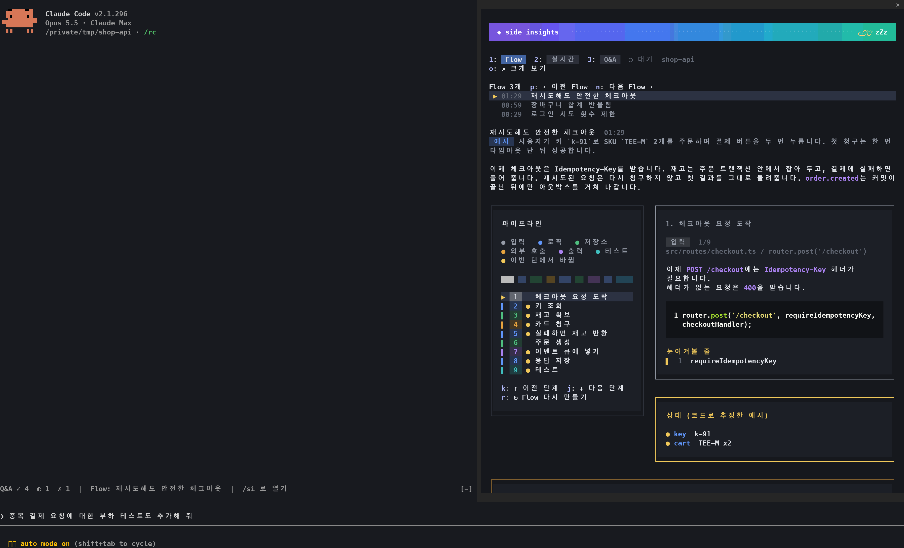 | 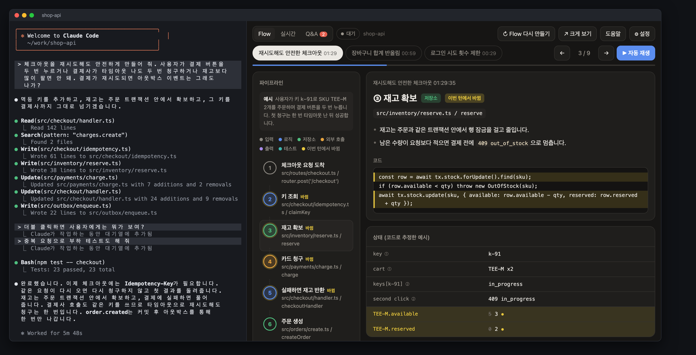 |

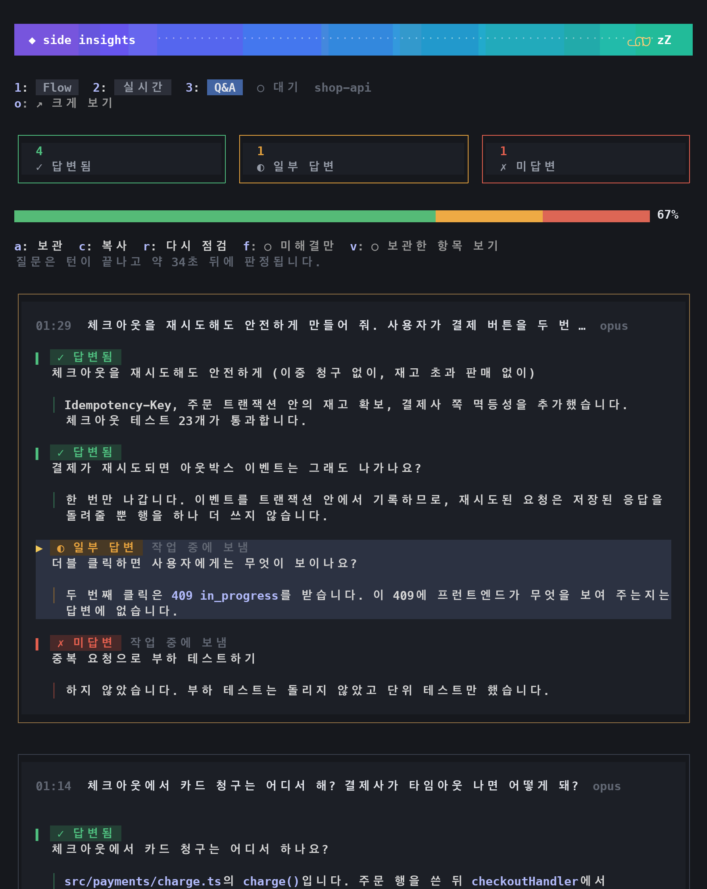

| Flow | 실시간 |
|---|---|
| 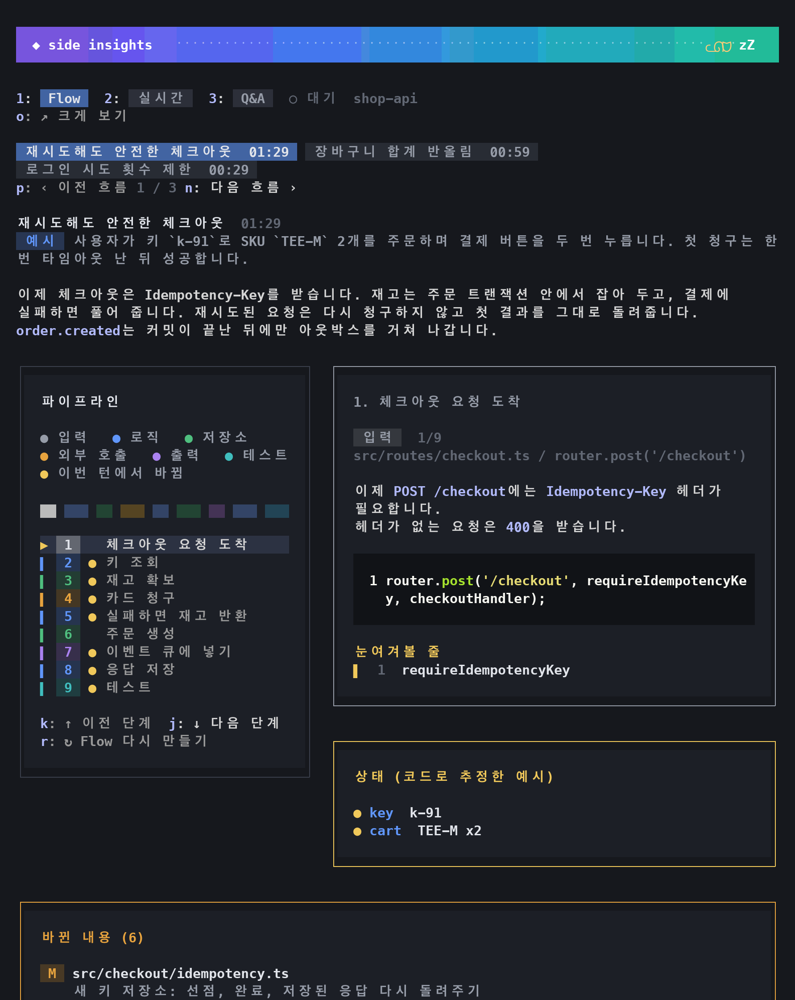 | 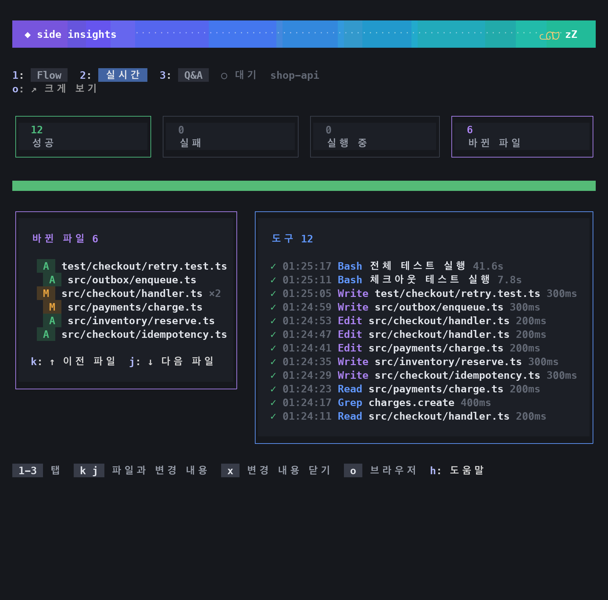 |
| **좁은 패널** | **도움말 (`h`)** |
| 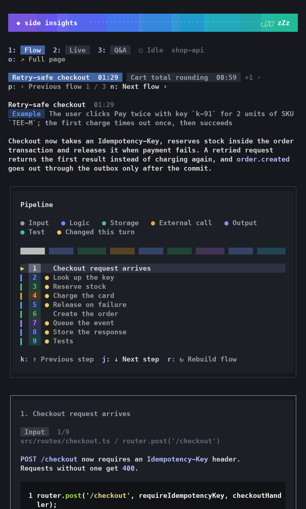 | 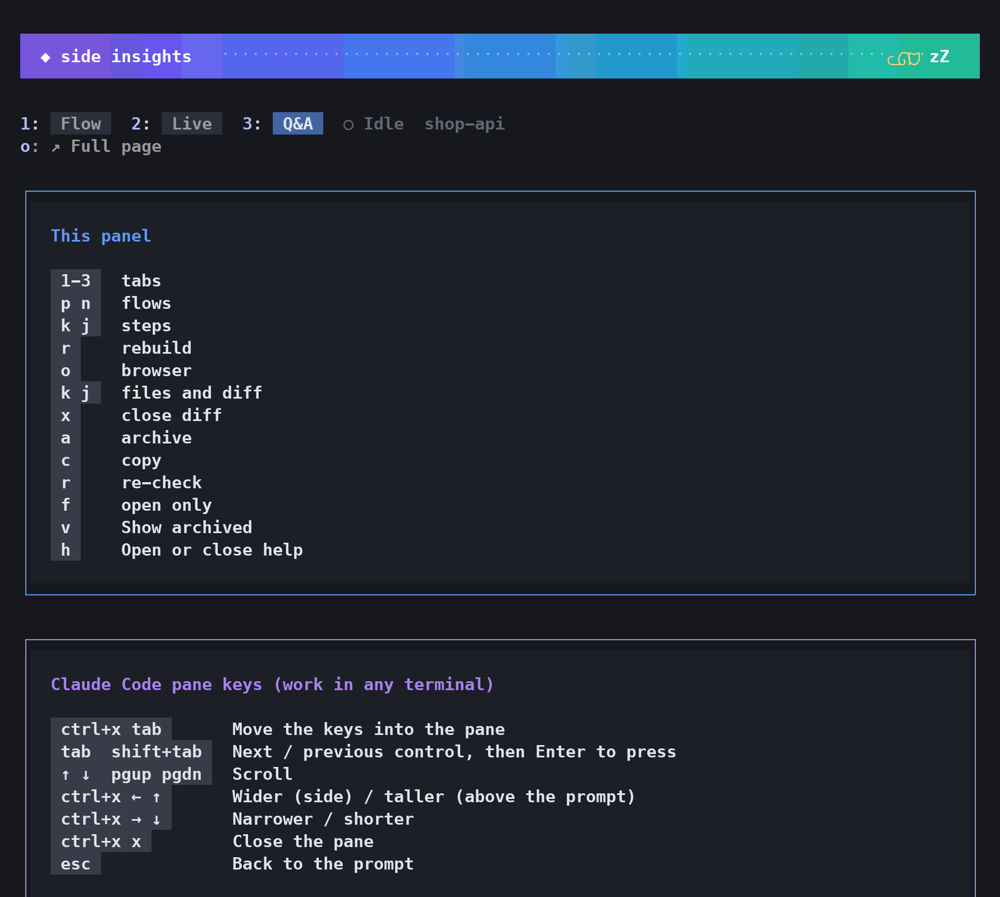 |

**Claude가 내 질문에 다 답했나? 무엇을 바꿨나? 지금 뭘 하고 있나?**

[Claude Code](https://claude.com/claude-code) 창 옆에 붙는 패널입니다. 턴이 끝날 때마다 갱신됩니다.

| 탭 | 보이는 것 |
|---|---|
| **Q&A** | 내가 한 모든 질문 (작업 중에 보낸 것 포함): ✓ 답변됨, ◐ 일부 답변, ✗ 미답변. 빠진 부분을 강조합니다. **⧉ 질문 복사**는 그 질문을 다시 묻는 메시지를 복사합니다. 그대로 붙여 넣으면 됩니다. |
| **Flow** | 파일을 바꾼 턴 뒤에 (수정, 또는 파일을 쓰는 셸 명령): 바뀐 기능을 단계별로, 실제 코드와 바뀐 줄 강조와 함께. |
| **실시간** | 도는 중인 도구 호출과 바뀐 파일. |

> [!WARNING]
> **Flow는 디버거가 아닙니다.** 턴이 끝난 뒤 모델이 바뀐 코드와 대화를 읽고 씁니다. 실제로 실행하거나 추적하지 않으므로 단계, 예시, 값이 틀리거나 지어낸 것일 수 있습니다. 믿기 전에 실제 코드를 확인하세요.

English, 한국어, 日本語를 지원합니다.

## 화면

*가상의 프로젝트로 만든 예시입니다.*

**브라우저 패널**: `/si-browser`로 엽니다. cmux에서는 브라우저 분할 창으로, 그 밖에서는 기본 브라우저로 열립니다.

| Q&A | Flow |
|---|---|
| 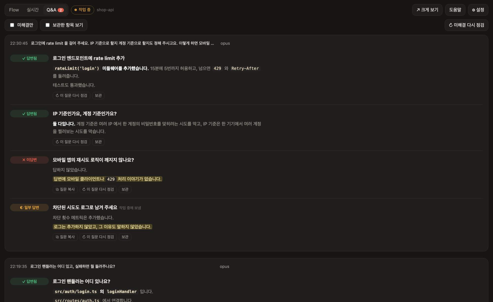 | 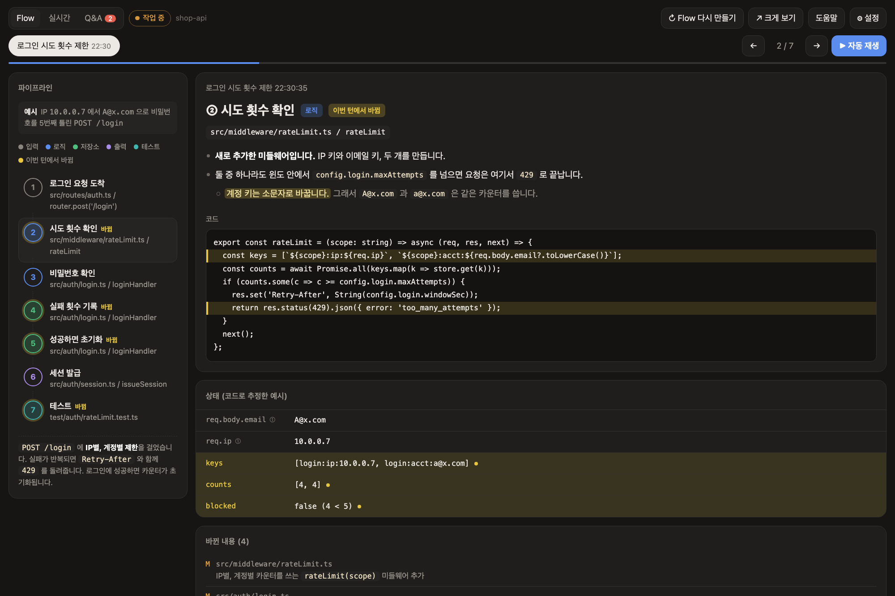 |
| **실시간** | **설정** |
| 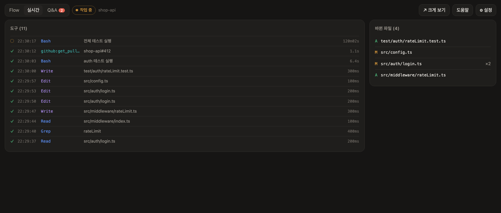 | 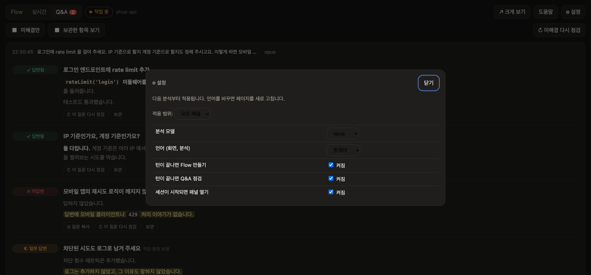 |

Flow 탭은 예시 하나를 모든 단계에 따라가며 보여 줍니다. 값은 코드에서 추론한 것이고 실행 중에 잡은 값이 아닙니다.

**터미널 패널**: iTerm2, Ghostty, Orca에서는 `! si-panel`이 예전 터미널 패널도 분할 창으로 엽니다. 탭은 같은 세 개입니다.

## 지원하는 터미널

`/si`는 Claude Code가 실행되는 모든 터미널에서 동작합니다. 아래 터미널에서는 `! si-panel`(cmux에서는 `/si-browser`도)로 Claude 옆에 패널을 열 수 있습니다.

| 터미널 | Claude 옆에 열리는 것 | 테스트 |
|---|---|---|
| [cmux](https://cmux.dev) | 전체 패널 (브라우저 split) | 함 |
| Orca | 터미널 패널 (split) | 함 |
| Ghostty 1.3 이상 | 터미널 패널 (split) | 함 |
| iTerm2 | 터미널 패널 (split) | 함 |
| 그 밖의 터미널 | `! si-panel`이 전체 패널을 브라우저로 엽니다 (숨기지는 못합니다). `/si`는 어디서나 됩니다 | 함 |

- 터미널 패널에도 Flow, 실시간, Q&A 세 탭이 있습니다. `! si-open`는 브라우저 버전을 엽니다.
- Ghostty, iTerm2는 AppleScript로 조작합니다. 처음 한 번 macOS가 권한을 묻습니다.
- 터미널 추가는 셸 파일 하나면 됩니다. [terminals/README.md](terminals/README.md) 참고.

## /si 패널

Claude Code 2.1.287 이상이 필요합니다 (2.1.296에서 테스트). Claude Code가 직접 그리므로 어느 터미널에서나 똑같이 보입니다. 키를 쓰기 전에 `ctrl+x tab` (또는 클릭)으로 키 입력을 패널로 옮기세요. 패널에서 쓰지 않는 영문자나 숫자를 누르면 프롬프트로 넘어가지 않고 안내가 뜹니다. 한글 입력 상태에서는 키가 먹지 않으니 영문 입력으로 바꾸세요. 단축키는 영문자와 숫자만 받습니다. Q&A에서는 질문을 클릭해서 고릅니다 (또는 Tab으로 옮겨 가서 Enter). 고르면 질문 전체가 복사됩니다. 처음에는 첫 번째 미해결 질문이 골라져 있습니다.

| 키 | 하는 일 |
|---|---|
| `/si` (또는 `/side-insights`) | 패널 열기. Claude가 턴을 진행하는 중에도 열립니다 |
| `/si-browser` | 브라우저 패널 보이기 / 숨기기. cmux에서는 분할 창, 그 밖에서는 기본 브라우저 |
| `1` `2` `3` | Flow, 실시간, Q&A |
| `p` `n` | Flow: 더 새로운 / 더 오래된 Flow (Flow 제목을 클릭해도 됨) |
| `k` `j` | Flow: 이전 / 다음 단계. 실시간: 이전 / 다음 바뀐 파일로 이동하고 변경 내용을 표시 |
| `d` `s` `f` | 변경 내용을 연 상태에서: 커밋 전 변경, 그 파일을 마지막으로 바꾼 커밋, 파일 전체 |
| `x` | 변경 내용 닫기 (`git diff`, 새 파일, 또는 그 파일을 마지막으로 바꾼 커밋) |
| `r` | Flow: Flow 다시 만들기. Q&A: 고른 질문 (또는 실패한 턴) 다시 점검. 두 번 눌러야 하고 Claude를 1회 호출합니다 |
| `a` `c` | Q&A: 고른 질문 보관 / 되돌리기. 아직 미해결이면 복사 |
| `f` `v` | Q&A: 미해결만 보기, 보관된 것 보기 |
| `m` | Q&A: 선택한 질문을 했던 위치로 대화를 스크롤합니다. 답변 줄을 클릭해도 같습니다. /si 패널에서만 되고, 지워지거나 압축된 대화는 찾을 수 없습니다 |
| `o` | 브라우저로 크게 보기 |
| `g` | 설정: 적용 범위 (모든 패널 / 이 패널만), 언어, 모델, 자동 실행, 세션이 시작되면 패널 열기, 테마. `k` `j`로 설정을 고르고 `p` `n`으로 값을 바꿉니다. `g`로 닫습니다 |
| `h` | 모든 키 (Claude Code 자체 패널 키 포함) |
| `ctrl+x ←` `ctrl+x →` | 넓게 / 좁게 (프롬프트 위에서는 `↑` `↓`). 구분선을 끌어도 됩니다 |

그 밖에:

- 실시간과 Q&A에서 개수 칸을 누르면 그 도구 호출이나 질문만 보입니다. 한 번 더 누르면 풀립니다.
- Flow 단계나 바뀐 내용 카드에서 바뀐 파일을 클릭해도 변경 내용이 열립니다.
- 폭이 78칸 이상이면 Flow와 실시간이 두 열로 나뉩니다.
- 프롬프트 위 한 줄에 Q&A 개수, 기다리는 질문, 최신 Flow가 보입니다.
- 스피너에 기다리는 질문 수가 붙습니다.
- 새 Flow가 준비되거나 점검 뒤 미해결 질문이 남으면 짧은 알림이 뜹니다.
- 다른 패널과 같은 로컬 서버에서 읽고, 서버가 꺼져 있으면 켭니다.

## 요구 사항과 설정

Claude Code 2.1.275 이상(`/si`와 `/si-browser`는 2.1.287 이상)과 Python 3.9 이상, 그리고 `jq`가 필요합니다. 플러그인은 도구 호출마다 작은 hook을 실행하는데, `jq`가 있으면 그 hook이 더 빠릅니다. `jq`가 없어도 Python으로 대신 동작합니다.

### macOS

1. Python: macOS에 들어 있는 것을 씁니다. `python3 --version`이 개발 도구 설치를 요청하면 `xcode-select --install`을 실행하세요.
2. [설치](#설치)대로 플러그인을 설치합니다.
3. `jq`: macOS 15 이상에는 기본으로 들어 있습니다. 그보다 오래된 macOS는 `brew install jq`.

모든 기능이 됩니다. `/si`, `/si-browser`, 터미널 패널, 그리고 cmux, Orca, Ghostty, iTerm2에서 Claude 옆에 열리는 패널까지.

### Linux

1. Python 3.9+: 보통 이미 있습니다. 없으면 `sudo apt install python3`(Debian, Ubuntu)나 `sudo dnf install python3`(Fedora).
2. [설치](#설치)대로 플러그인을 설치합니다.
3. `jq`: `sudo apt install jq`(Debian, Ubuntu) 또는 `sudo dnf install jq`(Fedora).
4. 선택: 복사 버튼용으로 `wl-clipboard`(Wayland)나 `xclip`(X11).

`/si`, `/si-browser`(기본 브라우저), 터미널 패널(`si-activity`, 별도 터미널에서 실행)이 됩니다. Claude 옆에 패널이 열리는 것은 Orca에서만 됩니다.

### Windows

Claude Code는 플러그인 hook을 Git for Windows에 들어 있는 Git Bash로 실행합니다.

1. Git for Windows(Claude Code에도 필요합니다): `winget install Git.Git`.
2. Python 3.9+: `winget install Python.Python.3.12`, 또는 python.org 설치 파일. Microsoft Store를 여는 `python3` 명령은 자리만 차지하는 바로 가기라서, 플러그인은 그것을 건너뛰고 `python`이나 `py`를 씁니다.
3. [설치](#설치)대로 플러그인을 설치하고 Claude Code를 다시 시작합니다.
4. `jq`: `winget install jqlang.jq` 후 Claude Code를 다시 시작해야 Git Bash가 찾습니다.

`/si`와 `/si-browser`(기본 브라우저)가 됩니다. 터미널 패널과 Claude 옆에 열리는 패널은 Windows에서 쓸 수 없습니다. Git을 특이한 위치에 설치했다면 `CLAUDE_CODE_GIT_BASH_PATH`에 그 `bash.exe` 경로를 넣으세요. Claude Code도 같은 변수를 씁니다.

### 설정 확인

Claude Code 안에서 `! si-panel`을 실행하세요. 빠진 것이 있으면 `side-insights needs: Python 3.9+`처럼 알려 줍니다.

## 명령

Claude Code 안에서 앞에 `!`를 붙여 실행합니다 (`si-activity`는 제외). 예: `! si-panel`

| 명령 | 하는 일 |
|---|---|
| `si-panel` | 이 창의 패널 보이기 / 숨기기 (분할 창을 못 여는 터미널에서는 브라우저 페이지를 엽니다) |
| `si-open` | 전체 패널을 브라우저로 열기 (`all`은 모든 창 목록) |
| `si-qa list [--open]` | 이 세션의 질문 목록 |
| `si-qa set <id> answered\|partial\|unanswered\|auto` | 상태 직접 바꾸기 |
| `si-qa archive <id>` / `restore <id>` | 항목 숨기기 / 되돌리기 |
| `si-activity` | 실시간 활동을 터미널 화면으로. `!` 뒤가 아니라 별도 터미널 창에서 실행하세요 |

브라우저 패널 단축키:

- `1` `2` `3`: Flow, 실시간, Q&A
- `←` `→`, Flow에서는 `k` `j`도: Flow 단계 이동. `p` `n`: 더 새로운 / 더 오래된 Flow
- 실시간 탭의 `k` `j`: 이전 / 다음 편집 파일과 변경 내용. `d` `s` `f`로 보기를 바꾸고 `x`로 닫습니다
- `?`: 도움말, `Esc`: 대화 상자 닫기

실시간이나 Flow에서 바뀐 파일을 누르면 /si와 같은 방식(커밋 전 변경, 마지막 커밋, 파일 전체)으로 변경 내용을 봅니다. 실시간과 Q&A의 숫자 타일을 누르면 목록이 걸러지고, 질문을 누르면 복사됩니다.

터미널 패널에서는 `h`를 누르면 모든 단축키가 나옵니다. Q&A에서 `↑` `↓`로 질문을 고르고 `s` 상태 바꾸기, `a` 보관, `c` 고른 질문 복사, `r` 다시 점검 (두 번 누름). `R`은 미해결 질문 전체를 다시 점검합니다 (역시 두 번 누름). Flow에서 `[` `]`로 Flow를 바꾸고 `p`로 단계를 자동으로 넘깁니다.

## 설정

- 브라우저 패널의 **⚙ 설정**이나 /si의 `g`로 엽니다. 다음 분석부터 적용되며 재시작은 필요 없습니다. 언어를 바꾸면 페이지를 다시 불러옵니다.
- **적용 범위**: **모든 패널** 또는 **이 패널만** (예: 한 창은 일본어, 다른 창은 한국어).
- 저장 위치: `~/.claude/side-insights/config.json`

| 설정 | 기본값 | 설명 |
|---|---|---|
| 분석 모델 | `opus` | `opus`, `sonnet`, `haiku` (전체 모델 id는 config.json에서 지정) |
| 언어 (화면, 분석) | 시스템 언어가 한국어나 일본어면 그 언어, 아니면 `en` | English, 한국어, 日本語 |
| 턴이 끝나면 Flow 만들기 | 켜짐 | 끄면 ↻ 버튼으로만 만듦 |
| 턴이 끝나면 Q&A 점검 | 켜짐 | 끄면 ↻ 버튼으로만 점검 |
| 세션이 시작되면 패널 열기 | 꺼짐 | 켜면 cmux, Orca, Ghostty, iTerm2에서 세션이 시작될 때 패널이 저절로 열림 |

환경변수: `SIDE_INSIGHTS_PORT`(기본 `47821`), `SIDE_INSIGHTS_DATA`(기본 `~/.claude/side-insights`).

## 자주 묻는 질문

**Claude 호출이 언제 더 생기나요? 사용량이 2배가 되나요?**

아닙니다. 턴이 끝날 때마다 Claude 호출이 최대 2번 더 생기고, 내 세션 밖에서 별도의 `claude -p`로 실행됩니다.

| 언제 | 무엇 | 추가 호출 | 조건 |
|---|---|---|---|
| 턴이 끝날 때 | Q&A 점검 | 1번 (도구 없음, 요청 1회) | "턴이 끝나면 Q&A 점검"이 켜져 있을 때 |
| 턴이 끝날 때 | Flow | 1번 (읽기 전용 도구를 써서 안에서 여러 번 요청) | 그 턴에 파일이 바뀌었고 (편집, 또는 파일을 쓰는 셸 명령) "턴이 끝나면 Flow 만들기"가 켜져 있을 때 |
| `r`을 누를 때 | 다시 점검 / 다시 만들기 | 누를 때마다 1번 | 두 번 눌러야 실행 |
| `/si` 패널 자체 | 화면, 키, 변경 내용, 테마 | 0번 | 로컬 서버와 git만 씀 |

일하는 턴 하나는 그 자체로 모델 요청을 보통 수십 번 하므로, 그 뒤에 붙는 분석 1~2번은 비중이 작습니다. 도구 없이 짧게 주고받는 턴이 많으면 매번 Q&A 점검이 붙어 비중이 커집니다.

그래서 전부 켜도 사용량이 3배가 되지는 않습니다. 전부 켜고 기본값 Opus로 잰 예: 분석 288번에 모두 약 $24가 들었습니다 (Q&A 1번에 약 $0.06, Flow 1번에 약 $0.17). 같은 컴퓨터에서 긴 작업 세션 하나는 모델 요청이 약 1,850번이었고, 토큰 수로 따지면 Opus 정가로 약 $500입니다. 분석 288번을 다 합쳐도 그 세션 하나의 5% 정도였습니다.

**비용** (Claude Code 정가 기준 추정)

| 무엇 | Claude 호출 | 비용 |
|---|---|---|
| 실시간 화면, 상태 변경, 보관 | 0 | 무료 |
| Q&A 점검, 매 턴 | 1 | Opus 기준 $0.04 ~ $0.11 |
| Flow, 파일을 바꾼 턴만 | 1 | $0.16 ~ $0.17 (Sonnet으로 잰 값. 기본값인 Opus는 더 비쌉니다) |
| ↻ 버튼 한 번 | 1 | 위와 같음 |

구독 요금제라면 사용량 한도에서 차감될 가능성이 큽니다 (확인 안 됨). 줄이려면 모델을 `sonnet`이나 `haiku`로 바꾸거나 ⚙ 설정에서 자동 실행을 끄세요.

**자주 나오는 질문**

| 질문 | 답 |
|---|---|
| 세션이 느려지거나 컨텍스트를 쓰나요? | 아니요. 턴이 끝난 뒤 별도 프로세스로 돕니다. |
| ↻ 실행이 파일을 고칠 수 있나요? | 아니요. 읽기 전용 도구만 씁니다. |
| 이번 턴에 Flow가 없어요 | 파일을 바꾼 턴에만 자동으로 만듭니다. 수정, 또는 파일을 쓰는 셸 명령이 있던 턴입니다. **↻ Flow 다시 만들기**를 누르세요. |
| 나중에 답했는데 미해결로 남아요 | 보통 다음 점검에서 풀립니다. 아니면 **↻ 미해결 다시 점검**이나 **↻ 이 질문 다시 점검**(/si에서는 `r`)을 누르거나, 브라우저 패널에서 상태를 직접 누르세요. 점검이 실패한 턴에는 **↻ 이 턴 다시 점검**이 나옵니다. |
| 패널을 숨기려면? | `! si-panel`로 숨기고 다시 엽니다. "세션이 시작되면 패널 열기"를 켰을 때만 저절로 열립니다. |
| `/si-browser`가 cmux 분할 대신 브라우저를 열어요 | 세션이 cmux 밖에서 돌고 있습니다 (예: 백그라운드 작업). cmux는 자기 안에서 시작한 프로세스의 명령만 받기 때문에 기본 브라우저로 대신 엽니다. cmux 터미널에서 Claude Code를 시작하면 분할로 열립니다. |

**데이터 위치**: `~/.claude/side-insights/`

| 경로 | 내용 |
|---|---|
| `config.json` | 설정 |
| `token` | 페이지와 `si-qa`가 쓰는 비밀값 |
| `logs/` | 도구 활동 |
| `turns/` | 창별로 마지막에 끝난 턴의 transcript와 폴더 |
| `flows/` | Flow |
| `qa/<창>/<세션>/` | Q&A, 세션별 |
| `qa/<창>/overrides.json` | 직접 바꾼 상태와 보관한 질문 |
| `terminals/` | 열려 있는 Orca 패널의 핸들 |
| `server.log`, `analysis.log` | 로컬 서버와 Flow, Q&A 실행 로그 |

## 동작 방식

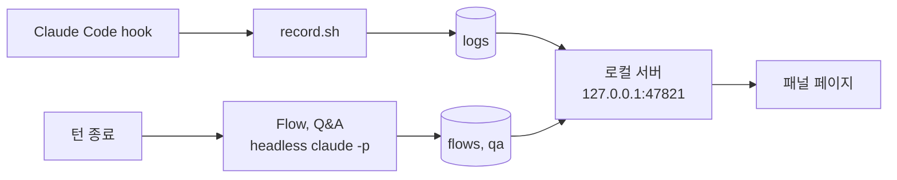

- 실시간 화면: hook이 이벤트마다 한 줄씩 기록합니다. 비용 없음.
- Flow, Q&A: 턴이 끝난 뒤 별도의 `claude -p`로 돕니다. 읽기 전용 도구만 쓰고 MCP와 hook은 없습니다. 작업 중인 세션의 컨텍스트는 건드리지 않습니다.
- Flow는 파일을 바꾼 턴에만 돕니다. 수정, 또는 파일을 쓰는 셸 명령이 있던 턴입니다. Q&A는 대화와 도구 목록만 읽고 파일은 읽지 않습니다.
- 패널은 터미널의 창 id로, 없으면 세션 id로 구분합니다.

## 데이터와 개인정보

- 모든 데이터는 `~/.claude/side-insights/`에 있고 내 계정만 읽을 수 있습니다.
- 서버는 127.0.0.1에서만 열리고, 호스트가 `127.0.0.1`이나 `localhost`인 요청만 받습니다 (DNS rebinding 차단).
- `/health`를 뺀 모든 페이지와 API는 비밀 토큰으로 보호됩니다. 토큰은 자동으로 만들어지고 `si-panel`, `si-open`가 여는 링크에 자동으로 붙으므로 직접 입력할 일은 없습니다. 다른 웹 페이지나 같은 컴퓨터의 다른 사용자는 토큰이 없어서 기록을 읽거나 유료 분석을 실행할 수 없습니다. `si-panel`이 출력하는 링크에는 토큰이 들어 있고 세션 기록에도 남으니, 비밀번호처럼 다루세요. `/si-browser`는 링크를 출력하지 않습니다.
- 토큰이 있으면 변경 내용 보기로 세션 작업 폴더 아래 파일과 세션이 편집한 파일을 볼 수 있습니다.

## 제거

```
/plugin uninstall side-insights@claude-side-insights
```

기록한 데이터는 `~/.claude/side-insights/`에 남습니다. 지우려면 그 폴더를 삭제하세요. 로컬 서버는 Mac을 다시 시작하면 꺼지고, 바로 끄려면 `pkill -f 'side_insights server'`를 실행하세요.

**예전 `install.sh` 버전을 쓰셨다면** 남은 것을 한 번 지워 주세요. `~/.claude/settings.json`에서 `~/.claude/activity-panel/record.sh`나 `open-panel.sh`를 가리키는 hook, `~/.zshrc`의 `claude-activity-panel` 블록, `~/.local/bin`의 `claude-panel`, `claude-flow`, `claude-qa`, `claude-activity`입니다.

## 라이선스

[MIT](LICENSE)
