# Claude Side Insights

**English** | [한국어](README.ko.md) | [日本語](README.ja.md)

## Install

Inside Claude Code:

```
/plugin marketplace add wonjoonSeol-WS/claude-side-insights
/plugin install side-insights@claude-side-insights
/reload-plugins
```

Then open the panel next to Claude:

```
! claude-panel
```

It also opens on its own when a new session starts in cmux, Orca, Ghostty or iTerm2. Run it again to hide it.

Update:

```
/plugin marketplace update claude-side-insights
/plugin update side-insights@claude-side-insights
```

Or turn on auto-update in `/plugin` > Marketplaces.

## What it shows

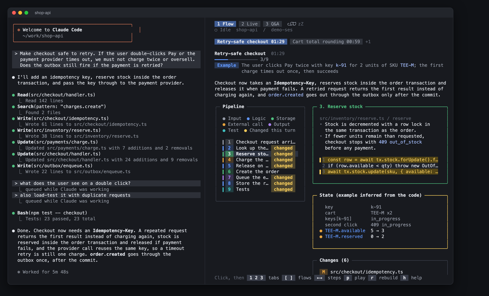

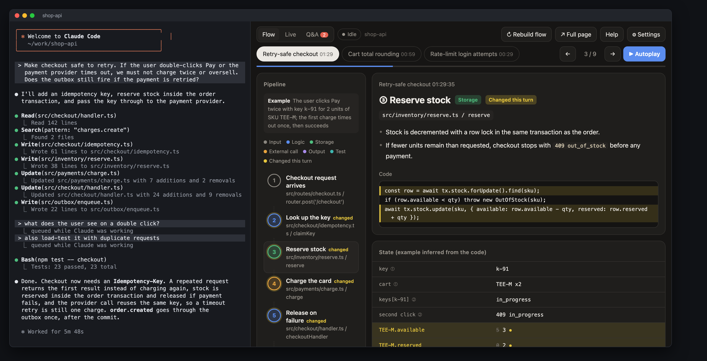

As a narrow side panel:

| Terminal | Browser |
|---|---|
| 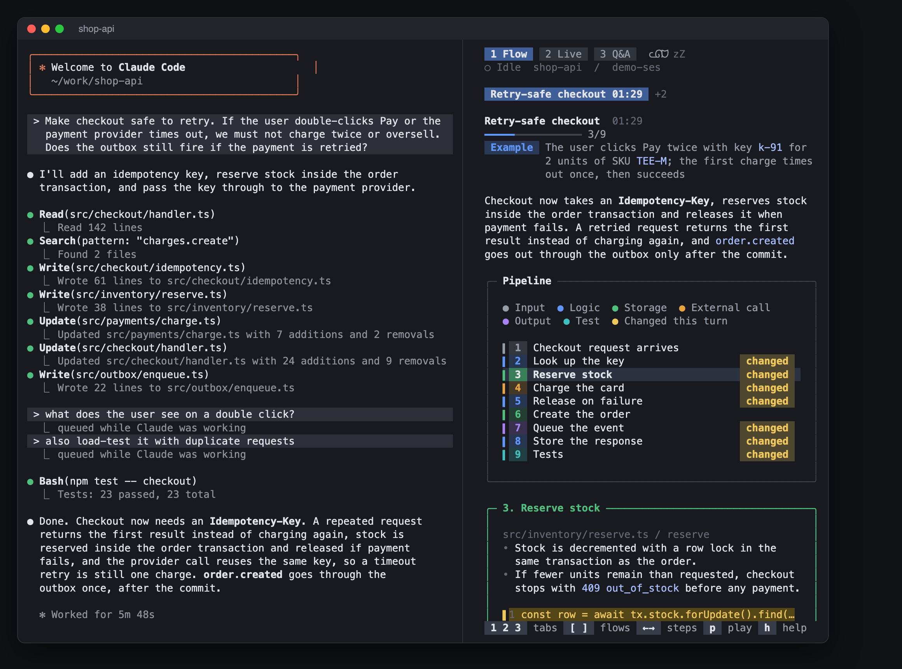 | 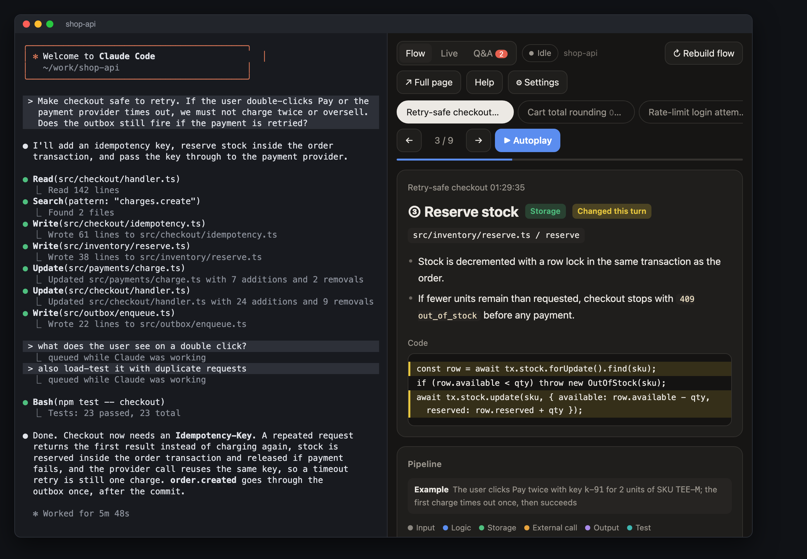 |


**Did Claude answer everything I asked? What did it change? What is it doing now?**

A panel next to each [Claude Code](https://claude.com/claude-code) pane, updated after every turn.

| Tab | What you see |
|---|---|
| **Q&A** | Every question you asked, even mid-turn: ✓ answered, ◐ partial, ✗ unanswered. The missing part is highlighted. **⧉ Copy question** asks it again. |
| **Flow** | After a turn that edited files: the changed feature step by step, with real code and the changed lines highlighted. |
| **Live** | Every tool call as it runs, and the files it changed. |

Available in English, 한국어 and 日本語.

## Screenshots

*Sample data from a made-up project.*

**Browser panel**, in terminals with a built-in browser such as cmux, or in your own browser with `claude-flow`:

| Q&A | Flow |
|---|---|
| 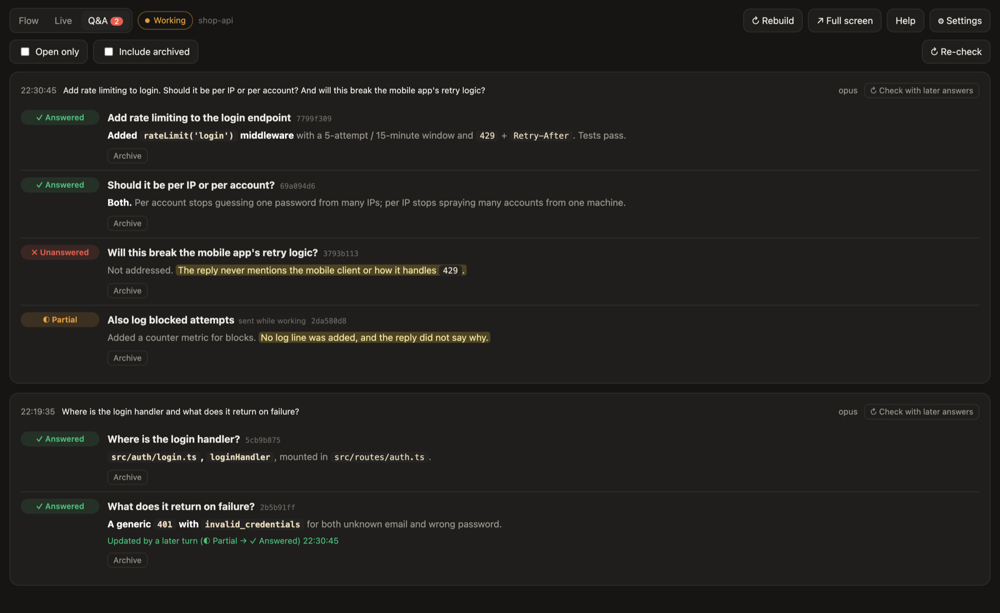 | 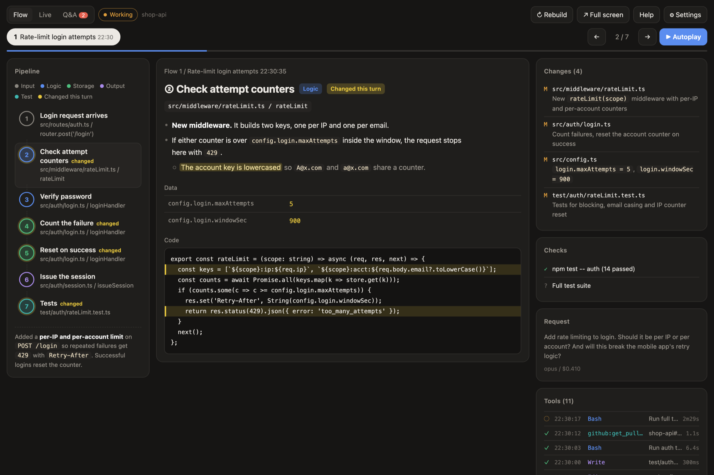 |
| **Live** | **Settings** |
| 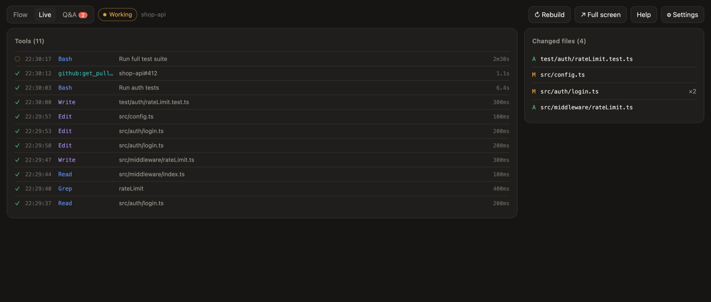 | 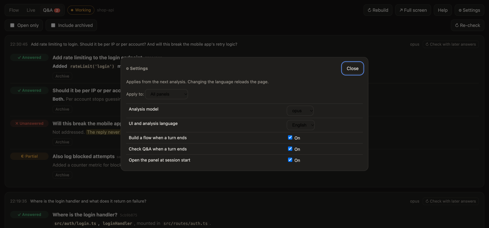 |

The Flow tab follows one example through every step. Its values are inferred from the code, not captured at runtime.

**Terminal panel** in iTerm2, Ghostty and Orca: the same three tabs, drawn in the terminal.

| Flow | Live | Q&A |
|---|---|---|
| 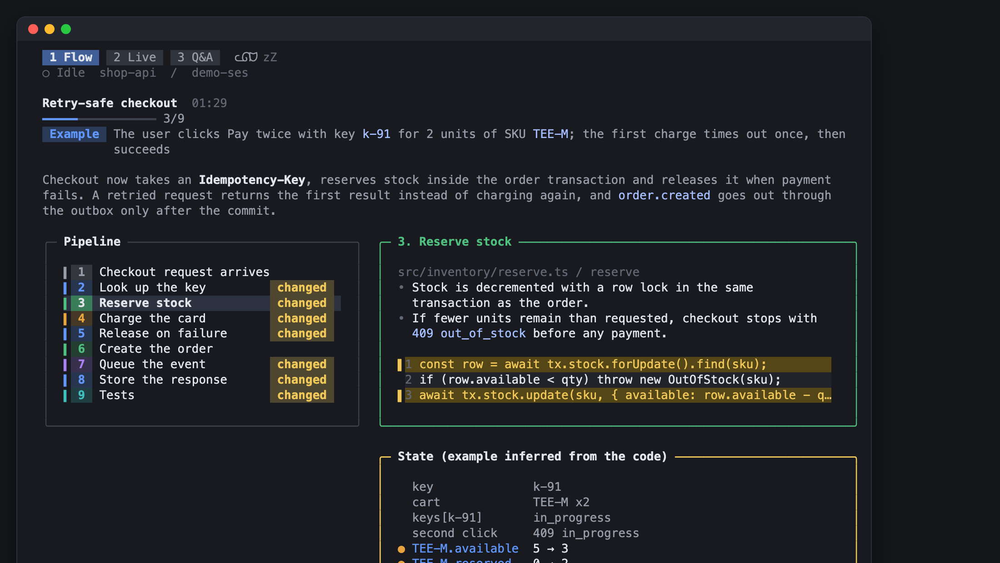 | 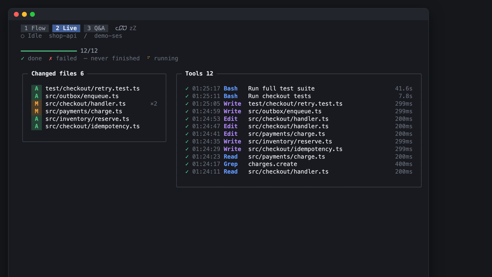 | 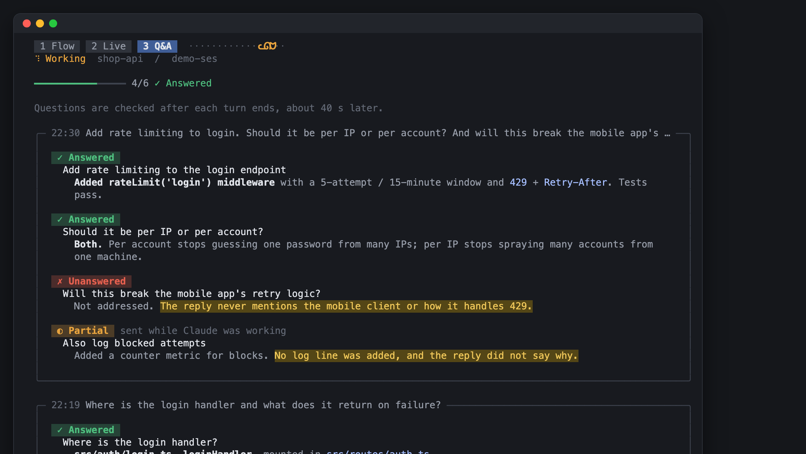 |

## Supported terminals

| Terminal | What opens next to Claude | Tested |
|---|---|---|
| [cmux](https://cmux.dev) | Full panel in a browser split | yes |
| Orca | Terminal panel in a split | yes |
| Ghostty 1.3+ | Terminal panel in a split | yes |
| iTerm2 | Terminal panel in a split | yes |
| Anything else | Nothing. Use the commands below | yes |

- The terminal panel has the same three tabs (Flow, Live, Q&A). `! claude-flow` opens the browser version.
- Ghostty and iTerm2 are driven by AppleScript. macOS asks once for permission.
- Adding a terminal is one small shell file. See [terminals/README.md](terminals/README.md).

## Requirements

- macOS (the plugin uses `osascript`, `open` and the system Python)
- Claude Code 2.1.275 or later
- `jq`, `curl`
- `/usr/bin/python3` 3.9+ (`xcode-select --install`)

## Commands

Run inside Claude Code with a leading `!`, for example `! claude-panel`.

| Command | What it does |
|---|---|
| `claude-panel` | Show or hide this pane's panel |
| `claude-flow` | Open the full panel in your browser (`all` lists every pane) |
| `claude-qa list [--open]` | List this session's questions |
| `claude-qa set <id> answered\|partial\|unanswered\|auto` | Set a status yourself |
| `claude-qa archive <id>` / `restore <id>` | Hide an item, or bring it back |
| `claude-activity` | Live activity as a terminal UI |

Keys in the panel:

- `1` `2` `3`: Flow, Live, Q&A
- `←` `→`: flow steps
- `?`: help, `Esc`: close

In the terminal panel, press `h` for every key. On Q&A, `↑` `↓` select a question, then `s` changes its status, `a` archives it, `c` copies it and `r` re-checks it. On Flow, `[` `]` switch flows and `p` plays the steps.

## Settings

- Open with **⚙** at the top right. Changes apply from the next analysis, no restart.
- **Apply to**: **All panels**, or **This panel only** (for example Japanese in one pane, Korean in another).
- Saved to `~/.claude/side-insights/config.json`.

| Setting | Default | Meaning |
|---|---|---|
| Analysis model | `opus` | `opus`, `sonnet` or `haiku` (set a full model id in config.json) |
| Language (UI and analysis) | `en` | English, 한국어, 日本語 |
| Build a flow when a turn ends | on | When off, flows are built only with the ↻ button |
| Check Q&A when a turn ends | on | When off, Q&A is checked only with the ↻ buttons |
| Open the panel when a session starts | on | When off, the panel opens only with `claude-panel` |

Environment variables: `SIDE_INSIGHTS_PORT` (default `47821`) and `SIDE_INSIGHTS_DATA` (default `~/.claude/side-insights`).

## FAQ

**Cost** (Claude Code list-price estimates)

| What | Claude calls | Cost |
|---|---|---|
| Live view, status changes, archiving | 0 | free |
| Q&A check, every turn | 1 | $0.04 to $0.11 on Opus |
| Flow, only after turns that edited files | 1 | $0.16 to $0.17 on Sonnet |
| Each ↻ button | 1 | same as above |

On a subscription this probably counts toward your usage limit (not confirmed). To spend less, pick `sonnet` or `haiku`, or turn off automatic runs in ⚙ Settings.

**Common questions**

| Question | Answer |
|---|---|
| Does it slow my session or use its context? | No. It runs in a separate process after the turn. |
| Can the ↻ runs change my files? | No. They use read-only tools. |
| Why no flow for this turn? | Flows run only after turns that edited files. Press **↻ Rebuild flow**. |
| Answered later, but still open? | The next check usually fixes it. Otherwise press **↻ Re-check open**, **↻ Re-check this question**, or click the status. A failed check shows **↻ Re-check this turn**. |
| How do I hide the panel? | `! claude-panel` hides and shows it. To stop it opening by itself, turn off "Open the panel when a session starts". |

**Where data lives**: `~/.claude/side-insights/`

| Path | What |
|---|---|
| `config.json` | settings |
| `token` | secret for the page and `claude-qa` |
| `logs/` | tool activity |
| `turns/` | transcript and folder of each pane's last finished turn |
| `flows/` | flows |
| `qa/<pane>/<session>/` | Q&A, per session |
| `qa/<pane>/overrides.json` | statuses you set |
| `terminals/` | handles of open terminal panels |
| `server.log`, `analysis.log` | output of the local server and of the flow and Q&A runs |

## How it works

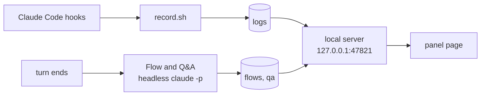

- Live view: hooks append a line per event. Free.
- Flow and Q&A: a separate `claude -p` after the turn. Read-only tools, no MCP, no hooks. Your session's context is untouched.
- Flow runs only after turns that edited files. Q&A reads the conversation and the tool list, not files.
- Panels are keyed by the terminal's pane id, else the session id.

## Data and privacy

- Everything stays in `~/.claude/side-insights/`, readable only by you.
- The server listens on 127.0.0.1 and only accepts `127.0.0.1` or `localhost` as host (no DNS rebinding).
- A secret token guards every page and API call. It is created and added to every link for you (`claude-panel`, `claude-flow`), so you never type it. Other web pages and other users on the machine don't have it, so they can't read your activity or start paid runs. The link `claude-panel` prints contains the token and ends up in your session transcript, so share it like a password.

## Uninstall

```
/plugin uninstall side-insights@claude-side-insights
```

Recorded data stays in `~/.claude/side-insights/`. Delete that folder to remove it too. The local server stops when you restart your Mac, or right away with `pkill -f 'side_insights server'`.

**Coming from the old `install.sh` version?** Remove its leftovers once: the hooks in `~/.claude/settings.json` that point at `~/.claude/activity-panel/record.sh` or `open-panel.sh`, the `claude-activity-panel` block in `~/.zshrc`, and `claude-panel`, `claude-flow`, `claude-qa` and `claude-activity` in `~/.local/bin`.

## License

[MIT](LICENSE)
