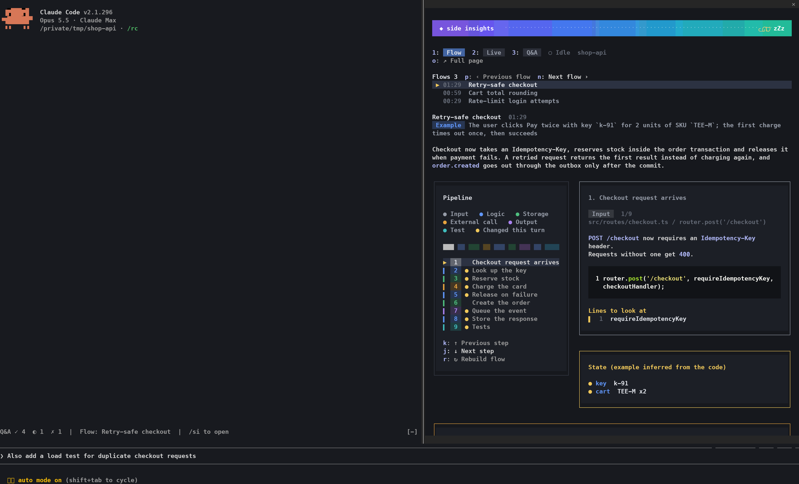
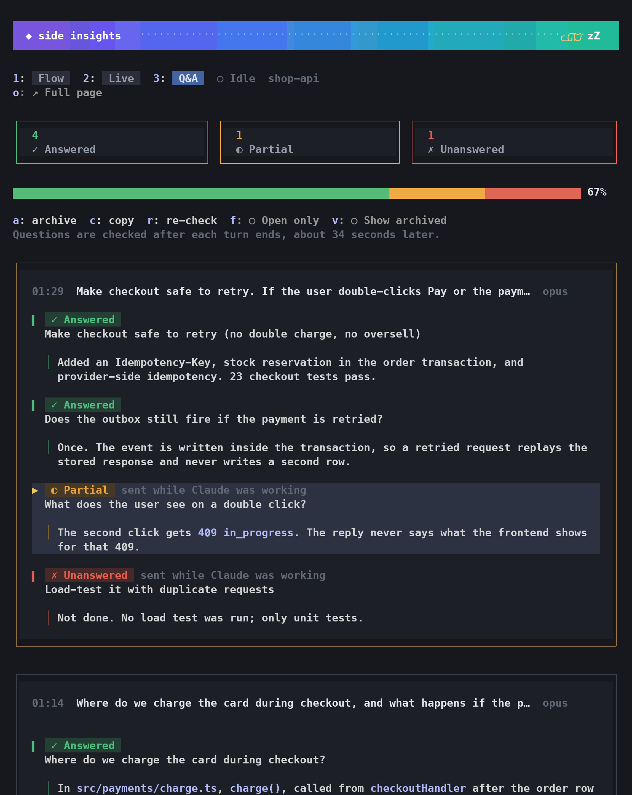
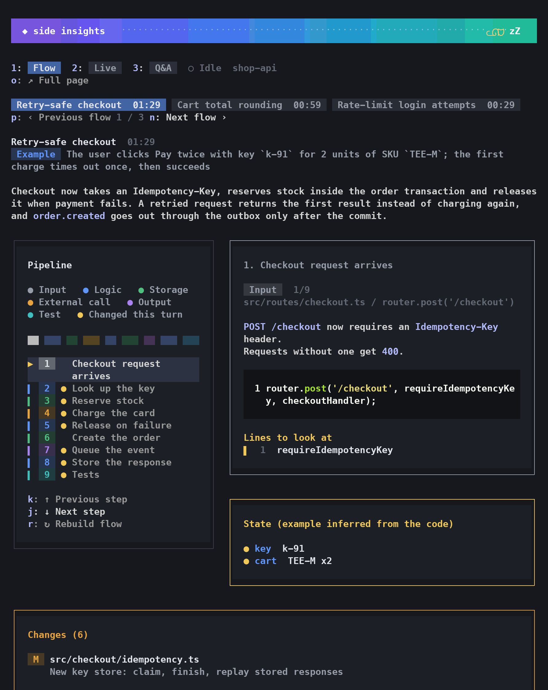
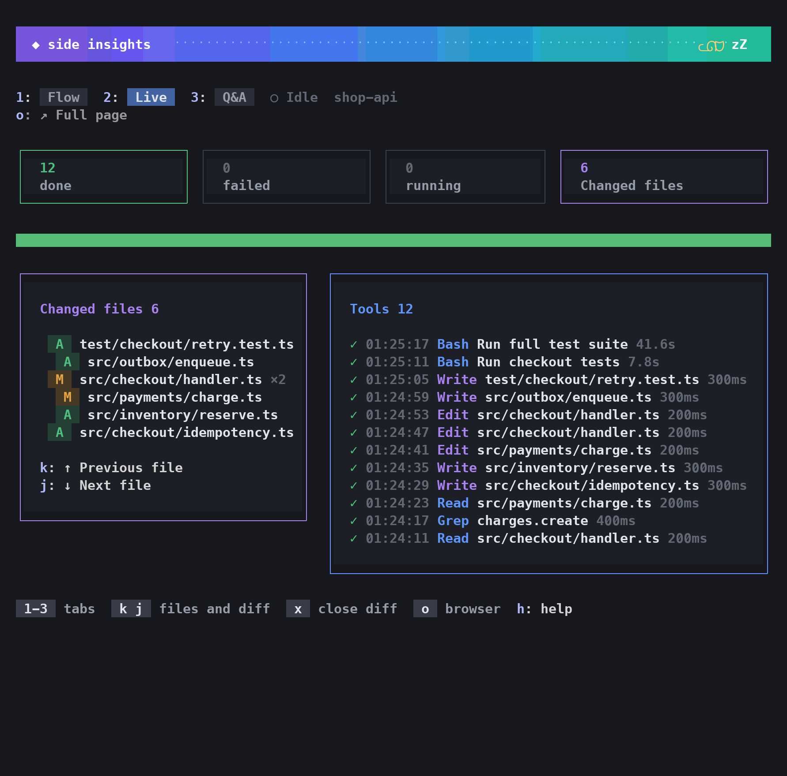
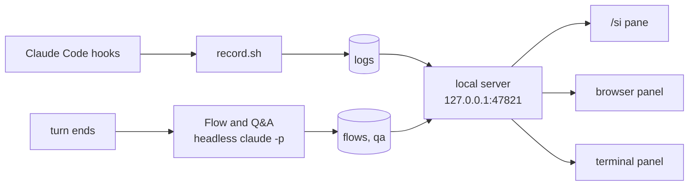

# Claude Side Insights

**English** | [한국어](README.ko.md) | [日本語](README.ja.md)

## Install

Works on macOS, Linux and Windows. Set up Python first if needed: see [Requirements and setup](#requirements-and-setup).

Inside Claude Code:

```
/plugin marketplace add wonjoonSeol-WS/claude-side-insights
/plugin install side-insights@claude-side-insights
/reload-plugins
```

Then open the panel inside Claude Code, as a pane or in a browser:

```
/si            # pane next to the session
/si-browser    # full panel in a browser
```

Close the pane with `ctrl+x x`. In cmux, `/si-browser` opens a browser split, and running it again hides it. Elsewhere it opens your default browser.

Update:

```
/plugin marketplace update claude-side-insights
/plugin update side-insights@claude-side-insights
```

Or turn on auto-update in `/plugin` > Marketplaces.

## What it shows

| `/si` pane, in any terminal | Browser panel, with `/si-browser` |
|---|---|
|  |  |



| Flow | Live |
|---|---|
|  |  |
| **Narrow pane** | **Help (`h`)** |
|  |  |

**Did Claude answer everything I asked? What did it change? What is it doing now?**

A panel next to each [Claude Code](https://claude.com/claude-code) pane. Live updates as Claude works; Q&A and Flow update after each turn.

| Tab | What you see |
|---|---|
| **Q&A** | Every question you asked, even mid-turn: ✓ answered, ◐ partial, ✗ unanswered. The missing part is highlighted. **⧉ Copy question** copies a message that asks the question again, ready to paste. |
| **Flow** | After a turn that changed files (edits, or shell commands that write files): the changed feature step by step, with real code and the changed lines highlighted. |
| **Live** | Every tool call as it runs, and the files Claude edited with Edit or Write (changes made by shell commands are not listed). Each file shows its name first, then its folder: the path inside the working folder, else the repo name and the path inside that git repo, else from `~` or `/`. A folder that does not fit goes on the line under the name, cut in the middle if it is still too long. The path, from the working folder or else from `~` or `/`, is in the diff header and on hover in the browser. |

> [!WARNING]
> **Flow is not a debugger.** A model writes it after the turn by reading the changed code and the conversation. Nothing is run or traced, so steps, the example and its values can be wrong or made up. Check the real code before you rely on it.

Available in English, 한국어 and 日本語.

## Screenshots

*Sample data from a made-up project.*

**Browser panel**, opened with `/si-browser`: a browser split in cmux, your own browser anywhere else:

| Q&A | Flow |
|---|---|
|  |  |
| **Live** | **Settings** |
|  |  |

The Flow tab follows one example through every step. Its values are inferred from the code, not captured at runtime.

**Terminal panel**: in iTerm2, Ghostty and Orca, `! si-panel` also opens the classic terminal panel in a split, with the same three tabs.

## Supported terminals

`/si` works in any terminal Claude Code runs in. `! si-panel` (and `/si-browser` in cmux) opens a panel next to Claude in these:

| Terminal | What opens next to Claude | Tested |
|---|---|---|
| [cmux](https://cmux.dev) | Full panel in a browser split | yes |
| Orca | Terminal panel in a split | yes |
| Ghostty 1.3+ | Terminal panel in a split | yes |
| iTerm2 | Terminal panel in a split | yes |
| Anything else | `! si-panel` opens the full panel in your browser (it cannot hide it). `/si` works everywhere | yes |

- The terminal panel has the same three tabs (Flow, Live, Q&A). `! si-open` opens the browser version.
- Ghostty and iTerm2 are driven by AppleScript. macOS asks once for permission.
- Adding a terminal is one small shell file. See [terminals/README.md](terminals/README.md).

## The /si pane

Needs Claude Code 2.1.287 or later (tested with 2.1.296). Claude Code draws it, so it looks the same in every terminal. Before using the keys, give the pane focus with `ctrl+x tab` or a click. A letter or digit the pane does not use shows a hint and is not sent to the prompt. With a non-Latin keyboard input source (for example 한글), switch to English first: hotkeys only accept Latin letters and digits. On Q&A, select a question by clicking it (or Tab to it and press Enter). This also copies the whole question. The first open question is selected by default. The footer lists only keys that can act now: with no flow yet, for example, the flow keys are left out.

| Key | What it does |
|---|---|
| `/si` (or `/side-insights`) | Open the pane. Works while Claude is still running a turn |
| `/si-browser` | Show or hide the browser panel: a split in cmux, your browser elsewhere |
| `1` `2` `3` | Flow, Live, Q&A |
| `p` `n` | Flow: newer / older flow (or click a flow title) |
| `k` `j` | Flow: previous / next step. Live: previous / next changed file, with its diff |
| `d` `s` `f` | With a diff open: uncommitted changes, the last commit that touched the file, the whole file |
| `x` | Close the diff (`git diff`, the new file, or the last commit that touched it) |
| `u` | Check now. Flow: build the flow for the latest turn. Q&A: check every turn not checked yet and re-check open questions. Live: refresh. Press it twice on Flow and Q&A; each is one Claude call |
| `r` | Flow: rebuild the flow, the same as `u` there. Q&A: re-check the selected question (or a failed turn). Press the same key twice. It uses one Claude call |
| `a` `c` | Q&A: archive or restore the selected question. Copy it while it is still open |
| `f` `v` | Q&A: show open questions only, show archived ones |
| `m` | Q&A: scroll the chat to where you asked the selected question. Clicking a line of an answer does the same. Only the /si pane can do this; a question cleared or compacted out of the chat cannot be reached |
| `o` | The full page in your browser |
| `g` | Settings: this panel on or off, which sessions, automatic runs, language, model, open on session start, theme. `k` `j` pick a setting, `p` `n` change it, `g` closes |
| `h` | Every key, including Claude Code's own pane keys |
| `ctrl+x ←` `ctrl+x →` | Wider / narrower (`↑` `↓` above the prompt). Dragging the divider works too |

Also:

- In Live and Q&A, press a count tile to show only those tool calls or questions. Press it again to clear.
- Diffs also open when you click a changed file in a Flow step or in the Changes card.
- From 78 columns wide, Flow and Live show two columns.
- A line above the prompt shows Q&A counts, waiting questions and the latest flow.
- The spinner shows how many of your questions are waiting.
- Waiting questions show only for a panel that is analyzed. A panel that is off still shows Live, and its turns are checked only when you press Check now or Check older.
- A short notice appears when a new flow is ready or a check leaves questions open.
- It reads from the same local server as the other panels, and starts it if needed.

## Requirements and setup

You need Claude Code 2.1.275 or later (2.1.287 or later for `/si` and `/si-browser`), Python 3.9 or later. `jq` is recommended: the plugin runs a small hook on every tool call, and `jq` makes it faster. Without `jq` the hook uses Python instead. The Orca split needs `jq`.

### macOS

1. Python: the one macOS ships. If `python3 --version` asks you to install developer tools, run `xcode-select --install`.
2. Install the plugin as shown in [Install](#install).
3. `jq`: built in on macOS 15 and later. On older macOS, `brew install jq`.

Everything works: `/si`, `/si-browser`, the terminal panel, and panels opening next to Claude in cmux, Orca, Ghostty and iTerm2.

### Linux

1. Python 3.9+: usually already there. Otherwise `sudo apt install python3` (Debian, Ubuntu) or `sudo dnf install python3` (Fedora).
2. Install the plugin as shown in [Install](#install).
3. `jq`: `sudo apt install jq` (Debian, Ubuntu) or `sudo dnf install jq` (Fedora).
4. Optional: `wl-clipboard` (Wayland) or `xclip` (X11) for the copy buttons.

`/si`, `/si-browser` (your default browser) and the terminal panel (`si-activity`, run in a separate terminal) work. Panels open next to Claude only in Orca.

### Windows

Claude Code runs plugin hooks in Git Bash, which comes with Git for Windows.

1. Git for Windows (Claude Code needs it anyway): `winget install Git.Git`.
2. Python 3.9+: `winget install Python.Python.3.12`, or the installer from python.org. The `python3` command that opens the Microsoft Store is only a placeholder; the plugin skips it and uses `python` or `py`.
3. Install the plugin as shown in [Install](#install), then restart Claude Code.
4. `jq`: `winget install jqlang.jq`, then restart Claude Code so its Git Bash finds it.

`/si` and `/si-browser` (your default browser) work. The terminal panel and panels opening next to Claude are not available on Windows. If Git is installed somewhere unusual, set `CLAUDE_CODE_GIT_BASH_PATH` to its `bash.exe`, the same variable Claude Code uses.

### Check the setup

Run `! si-panel` inside Claude Code. If something is missing, it says what, for example `side-insights needs: Python 3.9+`.

## Commands

Run inside Claude Code with a leading `!` (except `si-activity`), for example `! si-panel`.

| Command | What it does |
|---|---|
| `si-panel` | Show or hide this pane's panel (in terminals without a split, it opens the browser page) |
| `si-open` | Open the full panel in your browser (`all` lists every pane) |
| `si-qa list [--open]` | List this session's questions |
| `si-qa set <id> answered\|partial\|unanswered\|auto` | Set a status yourself |
| `si-qa archive <id>` / `restore <id>` | Hide an item, or bring it back |
| `si-activity` | Live activity as a terminal UI. Run it in a separate terminal pane, not after `!` |

Keys in the browser panel:

- `1` `2` `3`: Flow, Live, Q&A
- `←` `→`, or `k` `j` on Flow: flow steps. `p` `n`: newer / older flow
- `k` `j` on Live: previous / next edited file with its diff. `d` `s` `f` switch the diff view, `x` closes it
- `?`: help, `Esc`: close the dialog

Click a changed file on Live or Flow to see its diff, the same views as /si (uncommitted, last commit, whole file). The count tiles on Live and Q&A filter the list, and clicking a question copies it.

In the terminal panel, press `h` for every key. On Q&A, `↑` `↓` select a question, then `s` changes its status, `a` archives it, `c` copies the selected question and `r` re-checks it (press twice). `R` re-checks every open question (also press twice). On Flow, `[` `]` switch flows and `p` plays the steps.

## Settings

- Open with **⚙ Settings** in the browser panel or `g` in /si. Changes apply from the next analysis, no restart. Changing the language reloads the page.
- **Analyze this panel** belongs to the panel you are in. Every other setting is shared by all panels, so each panel shows the same values.
- Saved to `~/.claude/side-insights/config.json`.

| Setting | Default | Meaning |
|---|---|---|
| Analyze this panel | off until you open `/si` here | Opening `/si`, `/si-browser` or `! si-panel` turns it on; closing the `/si` pane yourself turns it off. Reloading a browser page does not turn it back on. While it is on, `/si` opens by itself when a session starts in this panel |
| Analyze which sessions | only panels opened with /si | **All sessions** analyzes every session, open or not, whichever panel you set it from |
| Build a flow when a turn ends | on | When off, flows are built only with Check now (`u`) or ↻ |
| Check Q&A when a turn ends | on | When off, turns stay pending until Check now (`u`) or ↻ |
| Q&A turns per check | 20 | How many pending turns one check covers: 5, 10, 20 or 30. Changing the model resets it to that model's default (Opus 20, Sonnet 10, Haiku 5); you can change it again afterwards. Bigger batches mean fewer calls, each bigger, and a smaller model judges them less reliably |
| Analysis model | `opus` | `opus`, `sonnet` or `haiku` (set a full model id in config.json) |
| Language (UI and analysis) | your system language if it is Korean or Japanese, else `en` | English, 한국어, 日本語 |
| Open the panel when a session starts | on | In cmux, Orca, Ghostty and iTerm2, the panel opens by itself when a session starts in an analyzed panel (or in any panel with **All sessions**) |
| Theme of the /si pane | follow Claude Code | Follow Claude Code, dark or light |

A "panel" is the terminal pane in cmux, Orca and iTerm2, so it stays on across sessions there. Elsewhere it is one Claude Code session, and resuming it reopens `/si`.

Environment variables: `SIDE_INSIGHTS_PORT` (default `47821`), `SIDE_INSIGHTS_DATA` (default `~/.claude/side-insights`) and `SIDE_INSIGHTS_PYTHON` (a Python 3.9+ to use instead of the one found, for example Homebrew's on a Mac without the Command Line Tools).

## FAQ

**When does it call Claude, and does it double my usage?**

No. By default it only analyzes sessions where you opened `/si`, and closing the pane stops it. At most two extra Claude calls run after each turn, as a separate `claude -p`, outside your session:

| When | What | Extra calls | Only if |
|---|---|---|---|
| A turn ends | Q&A check | 1 (no tools, one request) | this panel is analyzed (or all sessions are) and "Check Q&A when a turn ends" is on |
| A turn ends | Flow | 1 (read-only tools, so several requests inside) | the same, the turn changed files (edits, or shell commands that write files), and "Build a flow when a turn ends" is on |
| You switch a panel on by opening `/si` or `/si-browser` | Q&A for the latest turns (20 by default), Flow for the latest turn | up to 2 | the session already has turns; the flow only if that turn changed files and has none yet |
| You press `u`, `r` or ↻, or **Check older** | Check now / re-check / rebuild / the next batch of older turns | 1 per press | in `/si`, `u` and `r` run on the second press; browser buttons run at once |
| The `/si` pane itself | drawing, keys, diffs, theme | 0 | it only talks to the local server |

A single Q&A check covers at most the latest turns not checked yet, 20 by default (**Q&A turns per check**: 5, 10, 20 or 30). Older ones are listed as skipped on that turn's card, and **Check older** checks the next batch each time. Each batch is its own card.

When a turn continues the change of the previous flow (it refines, fixes or extends the same feature), the new flow replaces that one and covers both turns, so the list shows one up-to-date flow instead of near-duplicates.

A working turn usually makes dozens of model requests on its own, so one or two analysis runs after it are a small share. Many short chat-only turns raise the share, since each still gets a Q&A check.

So turning everything on does not triple your usage. One measurement, with everything on and the default Opus: 288 analysis runs cost about $24 in total (Q&A about $0.06 each, Flow about $0.17 each). A single long working session on the same machine made about 1,850 model requests, roughly $500 at Opus list price going by its token counts, so all 288 runs together came to about 5% of that one session.

**Cost** (Claude Code list-price estimates)

| What | Claude calls | Cost |
|---|---|---|
| Live view, status changes, archiving | 0 | free |
| Q&A check, every turn | 1 | $0.04 to $0.11 on Opus |
| Flow, only after turns that changed files | 1 | $0.16 to $0.17, measured on Sonnet. The default, Opus, costs more |
| Each ↻ button | 1 | same as above |

On a subscription this probably counts toward your usage limit (not confirmed). To spend less, pick `sonnet` or `haiku`, or turn off automatic runs in ⚙ Settings.

**Common questions**

| Question | Answer |
|---|---|
| Does it slow my session or use its context? | No. It runs in a separate process after the turn. |
| Can the ↻ runs change my files? | No. They use read-only tools. |
| Why no flow for this turn? | Flows run only after turns that changed files: edits, or shell commands that write files, and only in analyzed panels. Press **↻ Check now** (`u`) on Flow. |
| Answered later, but still open? | The next check usually fixes it. Otherwise press **↻ Re-check open** or **↻ Re-check this question** (`r` in /si), or click the status in the browser panel. A failed check shows **↻ Re-check this turn**. |
| How do I hide the panel? | Close the `/si` pane with `ctrl+x x`; that also stops analyzing this panel. `! si-panel` hides and shows the side panel. |
| How do I stop the extra calls? | Close the `/si` pane, or set **Analyze which sessions** back to **Only panels opened with /si**. To pause everywhere, turn off the two automatic runs. |
| `/si-browser` opens my browser instead of a cmux split | The session is running outside cmux, for example as a background job. cmux only accepts commands from processes started inside it, so the panel falls back to your default browser. Start Claude Code in a cmux terminal to get the split. |

**Where data lives**: `~/.claude/side-insights/`

| Path | What |
|---|---|
| `config.json` | settings |
| `token` | secret for the page and `si-qa` |
| `logs/` | tool activity |
| `turns/` | transcript and folder of each pane's last finished turn |
| `flows/` | flows |
| `qa/<pane>/<session>/` | Q&A, per session |
| `qa/<pane>/overrides.json` | statuses you set and archived questions |
| `terminals/` | handles of open Orca panels |
| `server.log`, `analysis.log` | output of the local server and of the flow and Q&A runs |

## How it works



- Live view: hooks append a line per tool call and edited file. This runs for every session, analyzed or not, and never calls Claude.
- Flow and Q&A: a separate `claude -p` after the turn, only for a panel that is analyzed (or with **All sessions**) and only while its automatic switch is on. No MCP, no hooks, and your session's context is untouched. Flow may use read-only tools; Q&A uses none.
- Flow runs only after turns that changed files: edits, or shell commands that write files. Q&A reads the conversation and the tool list, not files, and one check covers at most the latest unchecked turns (20 by default).
- One local server serves all panels and all sessions. The plugin starts it when a session starts and replaces it when it comes from another plugin version, so an update takes effect after `/reload-plugins`.
- Panels are keyed by the terminal's pane id, else the session id.

## Data and privacy

- Everything stays in `~/.claude/side-insights/`, readable only by you.
- The server listens on 127.0.0.1 and only accepts `127.0.0.1` or `localhost` as host (no DNS rebinding).
- A secret token guards every page and API call except `/health`. It is created and added to every link for you (`si-panel`, `si-open`), so you never type it. Other web pages and other users on the machine don't have it, so they can't read your activity or start paid runs. The link `si-panel` prints contains the token and ends up in your session transcript. Treat it like a password. `/si-browser` leaves the link out.
- With the token, the diff view can show any file under the session's working folder, plus files the session edited.

## Uninstall

```
/plugin uninstall side-insights@claude-side-insights
```

Recorded data stays in `~/.claude/side-insights/`. Delete that folder to remove it too. The local server stops when you restart your Mac, or right away with `pkill -f 'side_insights server'`.

**Coming from the old `install.sh` version?** Remove its leftovers once: the hooks in `~/.claude/settings.json` that point at `~/.claude/activity-panel/record.sh` or `open-panel.sh`, the `claude-activity-panel` block in `~/.zshrc`, and `claude-panel`, `claude-flow`, `claude-qa` and `claude-activity` in `~/.local/bin`.

## License

[MIT](LICENSE)

## Try my other projects

Like this? I make other small open source tools too: Android apps, a Claude chat game, Claude add-ons and more. See them all at [wonjoonseol-ws.github.io](https://wonjoonseol-ws.github.io/?from=claude-side-insights).
