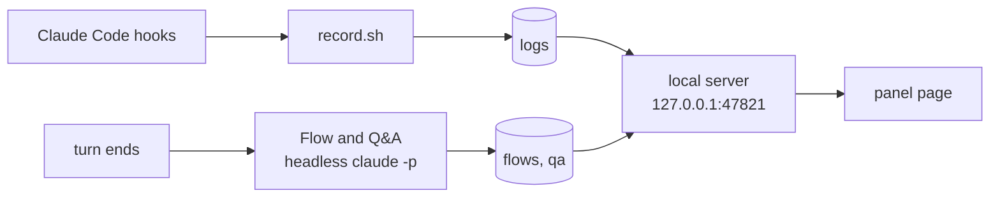

# Claude Side Insights

**English** | [한국어](README.ko.md) | [日本語](README.ja.md)

## Install

Inside Claude Code:

```
/plugin marketplace add wonjoonSeol-WS/claude-side-insights
/plugin install side-insights@claude-side-insights
/reload-plugins
```

Then open the panel inside Claude Code:

```
/si
```

Close the pane with `ctrl+x x`.

For the full panel in a browser, run `/si-browser`. In cmux it opens a browser split, and running it again hides it. Elsewhere it opens your default browser.

Update:

```
/plugin marketplace update claude-side-insights
/plugin update side-insights@claude-side-insights
```

Or turn on auto-update in `/plugin` > Marketplaces.

## What it shows

| `/si` pane, in any terminal | Browser panel, with `/si-browser` |
|---|---|
|  |  |


| Flow | Live |
|---|---|
|  |  |
| **Narrow pane** | **Help (`h`)** |
|  |  |

**Did Claude answer everything I asked? What did it change? What is it doing now?**

A panel next to each [Claude Code](https://claude.com/claude-code) pane. Live updates as Claude works; Q&A and Flow update after each turn.

| Tab | What you see |
|---|---|
| **Q&A** | Every question you asked, even mid-turn: ✓ answered, ◐ partial, ✗ unanswered. The missing part is highlighted. **⧉ Copy question** copies a message that asks the question again, ready to paste. |
| **Flow** | After a turn that changed files (edits, or shell commands that write files): the changed feature step by step, with real code and the changed lines highlighted. |
| **Live** | Every tool call as it runs, and the files Claude edited with Edit or Write (changes made by shell commands are not listed). |

> [!WARNING]
> **Flow is not a debugger.** A model writes it after the turn by reading the changed code and the conversation. Nothing is run or traced, so steps, the example and its values can be wrong or made up. Check the real code before you rely on it.

Available in English, 한국어 and 日本語.

## Screenshots

*Sample data from a made-up project.*

**Browser panel**, opened with `/si-browser`: a browser split in cmux, your own browser anywhere else (`! claude-flow` always opens it in your default browser):

| Q&A | Flow |
|---|---|
|  |  |
| **Live** | **Settings** |
|  |  |

The Flow tab follows one example through every step. Its values are inferred from the code, not captured at runtime.

**Terminal panel**: in iTerm2, Ghostty and Orca, `! claude-panel` also opens the classic terminal panel in a split, with the same three tabs.

## Supported terminals

`/si` works in any terminal Claude Code runs in. `! claude-panel` (and `/si-browser` in cmux) opens a panel next to Claude in these:

| Terminal | What opens next to Claude | Tested |
|---|---|---|
| [cmux](https://cmux.dev) | Full panel in a browser split | yes |
| Orca | Terminal panel in a split | yes |
| Ghostty 1.3+ | Terminal panel in a split | yes |
| iTerm2 | Terminal panel in a split | yes |
| Anything else | `! claude-panel` opens the full panel in your browser (it cannot hide it). `/si` works everywhere | yes |

- The terminal panel has the same three tabs (Flow, Live, Q&A). `! claude-flow` opens the browser version.
- Ghostty and iTerm2 are driven by AppleScript. macOS asks once for permission.
- Adding a terminal is one small shell file. See [terminals/README.md](terminals/README.md).

## The /si pane

Needs Claude Code 2.1.287 or later (tested with 2.1.296). Claude Code draws it, so it looks the same in every terminal. Before using the keys, give the pane focus with `ctrl+x tab` or a click. A letter or digit the pane does not use shows a hint and is not sent to the prompt. With a non-Latin keyboard input source (for example 한글), switch to English first: hotkeys only accept Latin letters and digits. On Q&A, select a question by clicking it (or Tab to it and press Enter). The first open question is selected by default.

| Key | What it does |
|---|---|
| `/si` (or `/side-insights`) | Open the pane. Works while Claude is still running a turn |
| `/si-browser` | Show or hide the browser panel: a split in cmux, your browser elsewhere |
| `1` `2` `3` | Flow, Live, Q&A |
| `p` `n` | Flow: newer / older flow (or click a flow title) |
| `k` `j` | Flow: previous / next step. Live: previous / next changed file, with its diff |
| `x` | Close the diff (`git diff`, the new file, or the last commit that touched it) |
| `r` | Flow: rebuild the flow. Q&A: re-check the selected question (or a failed turn). Press it twice. It uses one Claude call |
| `a` `c` | Q&A: archive or restore the selected question. Copy it while it is still open |
| `f` `v` | Q&A: show open questions only, show archived ones |
| `o` | The full page in your browser |
| `g` | Settings: apply to all panels or this one, language, model, automatic runs, open on session start |
| `h` | Every key, including Claude Code's own pane keys |
| `ctrl+x ←` `ctrl+x →` | Wider / narrower (`↑` `↓` above the prompt). Dragging the divider works too |

Also:

- In Live and Q&A, press a count tile to show only those tool calls or questions. Press it again to clear.
- Diffs also open when you click a changed file in a Flow step or in the Changes card.
- From 78 columns wide, Flow and Live show two columns.
- A line above the prompt shows Q&A counts, waiting questions and the latest flow.
- The spinner shows how many of your questions are waiting.
- A short notice appears when a new flow is ready or a check leaves questions open.
- It reads from the same local server as the other panels, and starts it if needed.

## Requirements

- macOS (the plugin uses `osascript`, `open` and the system Python)
- Claude Code 2.1.275 or later (2.1.287 or later for `/si` and `/si-browser`)
- `jq`, `curl`
- `/usr/bin/python3` 3.9+ (`xcode-select --install`)

## Commands

Run inside Claude Code with a leading `!` (except `claude-activity`), for example `! claude-panel`.

| Command | What it does |
|---|---|
| `claude-panel` | Show or hide this pane's panel (in terminals without a split, it opens the browser page) |
| `claude-flow` | Open the full panel in your browser (`all` lists every pane) |
| `claude-qa list [--open]` | List this session's questions |
| `claude-qa set <id> answered\|partial\|unanswered\|auto` | Set a status yourself |
| `claude-qa archive <id>` / `restore <id>` | Hide an item, or bring it back |
| `claude-activity` | Live activity as a terminal UI. Run it in a separate terminal pane, not after `!` |

Keys in the browser panel:

- `1` `2` `3`: Flow, Live, Q&A
- `←` `→`: flow steps
- `?`: help, `Esc`: close the dialog

In the terminal panel, press `h` for every key. On Q&A, `↑` `↓` select a question, then `s` changes its status, `a` archives it, `c` copies the selected question and `r` re-checks it (press twice). `R` re-checks every open question (also press twice). On Flow, `[` `]` switch flows and `p` plays the steps.

## Settings

- Open with **⚙ Settings** in the browser panel or `g` in /si. Changes apply from the next analysis, no restart. Changing the language reloads the page.
- **Apply to**: **All panels**, or **This panel only** (for example Japanese in one pane, Korean in another).
- Saved to `~/.claude/side-insights/config.json`.

| Setting | Default | Meaning |
|---|---|---|
| Analysis model | `opus` | `opus`, `sonnet` or `haiku` (set a full model id in config.json) |
| Language (UI and analysis) | your system language if it is Korean or Japanese, else `en` | English, 한국어, 日本語 |
| Build a flow when a turn ends | on | When off, flows are built only with the ↻ button |
| Check Q&A when a turn ends | on | When off, Q&A is checked only with the ↻ buttons |
| Open the panel when a session starts | off | When on, the panel opens by itself in cmux, Orca, Ghostty or iTerm2 when a session starts |

Environment variables: `SIDE_INSIGHTS_PORT` (default `47821`) and `SIDE_INSIGHTS_DATA` (default `~/.claude/side-insights`).

## FAQ

**Cost** (Claude Code list-price estimates)

| What | Claude calls | Cost |
|---|---|---|
| Live view, status changes, archiving | 0 | free |
| Q&A check, every turn | 1 | $0.04 to $0.11 on Opus |
| Flow, only after turns that changed files | 1 | $0.16 to $0.17, measured on Sonnet. The default, Opus, costs more |
| Each ↻ button | 1 | same as above |

On a subscription this probably counts toward your usage limit (not confirmed). To spend less, pick `sonnet` or `haiku`, or turn off automatic runs in ⚙ Settings.

**Common questions**

| Question | Answer |
|---|---|
| Does it slow my session or use its context? | No. It runs in a separate process after the turn. |
| Can the ↻ runs change my files? | No. They use read-only tools. |
| Why no flow for this turn? | Flows run only after turns that changed files: edits, or shell commands that write files. Press **↻ Rebuild flow**. |
| Answered later, but still open? | The next check usually fixes it. Otherwise press **↻ Re-check open** or **↻ Re-check this question** (`r` in /si), or click the status in the browser panel. A failed check shows **↻ Re-check this turn**. |
| How do I hide the panel? | `! claude-panel` hides and shows it. It opens by itself only if "Open the panel when a session starts" is on. |

**Where data lives**: `~/.claude/side-insights/`

| Path | What |
|---|---|
| `config.json` | settings |
| `token` | secret for the page and `claude-qa` |
| `logs/` | tool activity |
| `turns/` | transcript and folder of each pane's last finished turn |
| `flows/` | flows |
| `qa/<pane>/<session>/` | Q&A, per session |
| `qa/<pane>/overrides.json` | statuses you set and archived questions |
| `terminals/` | handles of open Orca panels |
| `server.log`, `analysis.log` | output of the local server and of the flow and Q&A runs |

## How it works



- Live view: hooks append a line per event. Free.
- Flow and Q&A: a separate `claude -p` after the turn. Read-only tools, no MCP, no hooks. Your session's context is untouched.
- Flow runs only after turns that changed files: edits, or shell commands that write files. Q&A reads the conversation and the tool list, not files.
- Panels are keyed by the terminal's pane id, else the session id.

## Data and privacy

- Everything stays in `~/.claude/side-insights/`, readable only by you.
- The server listens on 127.0.0.1 and only accepts `127.0.0.1` or `localhost` as host (no DNS rebinding).
- A secret token guards every page and API call except `/health`. It is created and added to every link for you (`claude-panel`, `claude-flow`), so you never type it. Other web pages and other users on the machine don't have it, so they can't read your activity or start paid runs. The links `claude-panel` and `/si-browser` print contain the token and end up in your session transcript. Treat them like a password.

## Uninstall

```
/plugin uninstall side-insights@claude-side-insights
```

Recorded data stays in `~/.claude/side-insights/`. Delete that folder to remove it too. The local server stops when you restart your Mac, or right away with `pkill -f 'side_insights server'`.

**Coming from the old `install.sh` version?** Remove its leftovers once: the hooks in `~/.claude/settings.json` that point at `~/.claude/activity-panel/record.sh` or `open-panel.sh`, the `claude-activity-panel` block in `~/.zshrc`, and `claude-panel`, `claude-flow`, `claude-qa` and `claude-activity` in `~/.local/bin`.

## License

[MIT](LICENSE)
